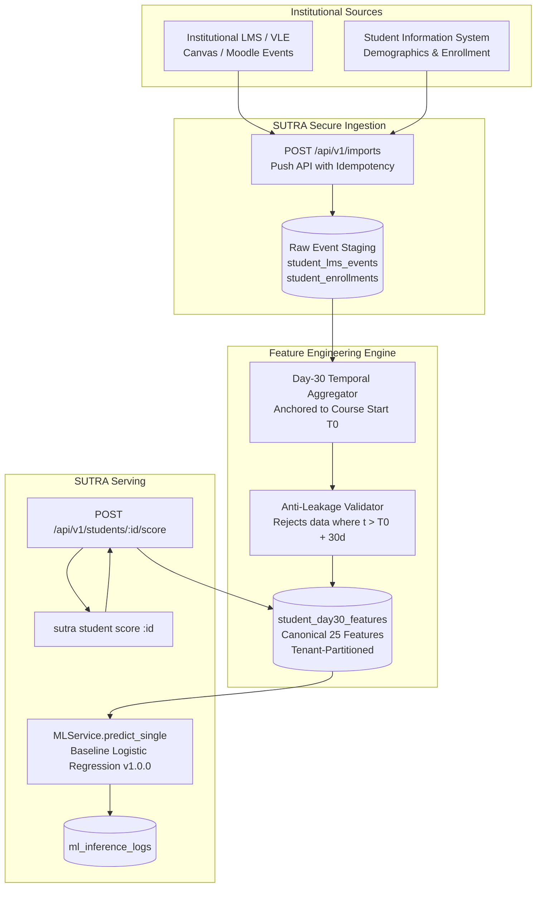

# SUTRA CLI — Phase 3B.2: Student Feature Data Pipeline Investigation

**Date:** 2026-10-12  
**Auditor / Role:** Senior ML Data Systems & Privacy Auditor  
**Repository:** `/Users/neemaysmac/Desktop/Sutra`  
**Scope:** Read-only architectural investigation of student activity sources, LMS/SIS integration status, feature provenance, and feasibility of constructing the 25 canonical Day-30 features for live student scoring (`sutra student score <STUDENT_ID>`).  
**Status:** **Audit Completed — No application code, database schema, model weights, or production data was modified.**  

---

## 1. Executive Summary & Readiness Verdict

### Final Verdict: **`FEATURE DATA UNAVAILABLE`**

While SUTRA has established secure model serving (`POST /api/v1/ml/predict`), secured root compatibility aliases (`POST /predict`), and a working file-based CLI predictor (`sutra predict --file <PATH>`), **the operational application database currently lacks the underlying activity records required to construct the 25 Day-30 OULAD features for any student**.

### Key Findings:
1. **LMS/SIS Integrations Do Not Exist:** There are zero operational API clients, webhooks, or synchronization jobs for Learning Management Systems (Canvas, Moodle, Blackboard) or Student Information Systems (Banner, Workday, PeopleSoft). The identifier `"canvas_lms_v2"` exists exclusively as a hardcoded mock label in tests and documentation.
2. **Database Domain Mismatch:** The PostgreSQL operational database ([`app/models/observation.py`](file:///Users/neemaysmac/Desktop/Sutra/app/models/observation.py)) is structured around five general educational indicators (`attendance_rate`, `missing_assignments_count`, `latest_score`, `weekly_activity_count`, `skill_rubric_status`). It possesses **zero** tables or columns for VLE clickstreams, site resource categories, course start dates, or demographic baseline attributes.
3. **Policy Engine Corroboration:** In [`app/services/policy_engine.py:258`](file:///Users/neemaysmac/Desktop/Sutra/app/services/policy_engine.py#L258), the policy engine tests `all(k in metrics for k in DAY30_REQUIRED_FEATURES)`. For every student in PostgreSQL, this evaluates to false, setting:
   `"ml_applicability": "insufficient_oulad_features"`.
4. **Research vs Operational Distinction:** The canonical 25 features exist solely in offline research CSVs from the 2015 Open University Learning Analytics Dataset (`ml/data/raw/`) and in static demo test vectors (`docs/fixtures/demo_seed.json`). No live university student can currently be scored by ID.

---

## 2. Inventory of Actual Student Activity Sources

The repository was searched for all historical and operational student activity data. The findings are categorized below:

### 2.1 Live Operational Application Database (PostgreSQL)

| Component | Repository Path | Nature & Trustworthiness | Identifiers & Linking | Retention & Privacy |
| :--- | :--- | :--- | :--- | :--- |
| **`students` table** | [`app/models/student.py`](file:///Users/neemaysmac/Desktop/Sutra/app/models/student.py) | **Operational Schema.** Stores pseudonymous student profiles. No demographic attributes. | `id` (UUID PK), `institution_id` (FK), `external_ref` (string, e.g. `"SYN-1007"`), `cohort_code` (e.g. `"CS-Y2"`). | Tenant-scoped by `institution_id`. Subject to `processing_authorizations`. |
| **`student_observations` table** | [`app/models/observation.py`](file:///Users/neemaysmac/Desktop/Sutra/app/models/observation.py) | **Operational Schema.** Stores general educational indicators across 5 domains (`attendance`, `academic`, `participation`, `skills`, `faculty_feedback`). **No VLE click streams.** | `student_id` (FK `students.id`), `institution_id`, `metric_key`, `event_at`, `available_at`, `quality_state`. | Strictly partitioned by campus. Time-indexed with anti-tamper constraints. |
| **`finance_observations` table** | [`app/models/observation.py`](file:///Users/neemaysmac/Desktop/Sutra/app/models/observation.py) | **Segregated Schema (ADR-003).** Stores fee relief records. Strictly isolated from ML features. | `student_id`, `institution_id`, `fee_support_status`. | Gated strictly to `"finance"` and `"institution_admin"`. Forbidden in ML. |
| **`source_imports` table** | [`app/models/observation.py`](file:///Users/neemaysmac/Desktop/Sutra/app/models/observation.py) | **Operational Schema.** Audits external push imports received via `POST /api/v1/imports`. | `idempotency_key`, `file_digest`, `rows_received`, `rows_accepted`, `status`. | Stores digest and row error logs. |

### 2.2 Offline Research Data (`ml/data/raw/`)

| Artifact | Size | Provenance & Source | Schema Content | Status in Product |
| :--- | :--- | :--- | :--- | :--- |
| **`anonymisedData.zip`** | 46.8 MB | Open University Learning Analytics Dataset (OULAD), Open Government Licence v2.0 (DOI `10.6084/m9.figshare.5081998.v1`). | Complete archive of 7 OULAD CSV tables. MD5: `7412686fd77cf0e0ee1e8c3e9b354308`. | Offline research only. Unlinked to application database. |
| **`studentVle.csv`** | 453.8 MB | Authentic OULAD clickstream (10.6M interaction rows). | `code_module`, `code_presentation`, `id_student`, `id_site`, `date`, `sum_click`. | Used by `ml/pipelines/run_prep.py` to train baseline model. Not in PostgreSQL. |
| **`vle.csv`** | 260 KB | Authentic OULAD activity metadata (6,364 sites). | `id_site`, `code_module`, `code_presentation`, `activity_type` (`forumng`, `oucontent`, `quiz`, `homepage`, `other`). | Required to split clicks into canonical categories. |
| **`studentInfo.csv`** | 3.5 MB | Authentic OULAD demographic and course registrations (32,593 rows). | `id_student`, `gender`, `region`, `highest_education`, `imd_band`, `age_band`, `num_of_prev_attempts`, `studied_credits`, `disability`, `final_result`. | Source of all 8 demographic features. |
| **`studentRegistration.csv`**| 1.1 MB | Authentic OULAD registration dates. | `id_student`, `date_registration` (days relative to start), `date_unregistration`. | Source of `days_registered_before_start`. |
| **`studentAssessment.csv`** | 5.7 MB | Authentic OULAD assessment submissions. | `id_student`, `id_assessment`, `date_submitted`, `is_banked`, `score`. | Source of `assessments_submitted_d30`. |

### 2.3 Synthetic Test Data & Demonstration Fixtures

| Artifact | Repository Path | Nature & Content | Usage |
| :--- | :--- | :--- | :--- |
| **`demo_seed.json`** | [`docs/fixtures/demo_seed.json`](file:///Users/neemaysmac/Desktop/Sutra/docs/fixtures/demo_seed.json) | **Fictional Demonstration Seed.** Contains 6 synthetic students (`SYN-1007` to `SYN-1012`) and one static 25-feature vector block (`ml_day30_test_vector`). | Used for playground UI and CLI unit tests. Expressly prohibited for clinical claims. |
| **`synthetic_batch_100.json`**| [`ml/data/synthetic/`](file:///Users/neemaysmac/Desktop/Sutra/ml/data/synthetic) | **Synthetic Dataset.** 100 pseudo-random vectors generated with seed `42` for pipeline stress testing. | Strictly non-causal software mechanics testing. Explicit prohibition against computing accuracy. |

---

## 3. The 25-Feature Source-Mapping Table

This table maps the canonical 25 Day-30 OULAD features required by the production model ([`app/schemas/ml.py`](file:///Users/neemaysmac/Desktop/Sutra/app/schemas/ml.py)) against the data available in SUTRA.

| # | Feature Name | Required Source Field & Window Definition | Source in SUTRA PostgreSQL? | Operational & Trustworthy? | Can Valid Day-30 Value Be Computed? | Missing Prerequisites / Blockers |
| :-: | :--- | :--- | :--- | :--- | :--- | :--- |
| 1 | `num_of_prev_attempts` | Prior course attempts on module before term start | ❌ None | ❌ Unavailable | ❌ No | No SIS course enrollment history in DB. |
| 2 | `studied_credits` | Cumulative attempted credits enrolled at start of term | ❌ None | ❌ Unavailable | ❌ No | No credit load tracked in `students`. |
| 3 | `gender` | Student demographic gender (`M`/`F`) | ❌ None | ❌ Unavailable | ❌ No | Demographic attributes not stored in `students`. |
| 4 | `region` | Geographic region of residence | ❌ None | ❌ Unavailable | ❌ No | Demographic attributes not stored in `students`. |
| 5 | `highest_education` | Highest prior educational qualification achieved | ❌ None | ❌ Unavailable | ❌ No | Demographic attributes not stored in `students`. |
| 6 | `imd_band` | Index of Multiple Deprivation decile band | ❌ None | ❌ Unavailable | ❌ No | Socioeconomic attributes not stored in `students`. |
| 7 | `age_band` | Age bracket at course start (`0-35`, `35-55`, `55<=`) | ❌ None | ❌ Unavailable | ❌ No | Demographic attributes not stored in `students`. |
| 8 | `disability` | Registered disability indicator (`Y`/`N`) | ❌ None | ❌ Unavailable | ❌ No | Health/disability attributes not stored in `students`. |
| 9 | `days_registered_before_start` | Number of days registered before course start date ($T_0$) | ❌ None | ❌ Unavailable | ❌ No | Course start date ($T_0$) not tracked; registration date not recorded. |
| 10 | `has_missing_registration_date`| Binary flag if registration date was unrecorded | ❌ None | ❌ Unavailable | ❌ No | Registration date not recorded. |
| 11 | `vle_total_clicks_d30` | Cumulative clicks accumulated in window $[-\infty, T_0 + 30\text{d}]$ | ❌ None | ❌ Unavailable | ❌ No | No LMS clickstream event logging table exists in PostgreSQL. |
| 12 | `vle_active_days_d30` | Distinct calendar days with recorded VLE clicks $\le 30\text{d}$ | ❌ None | ❌ Unavailable | ❌ No | No daily interaction timestamps stored. |
| 13 | `vle_clicks_precourse` | Total clicks recorded prior to course start ($t < T_0$) | ❌ None | ❌ Unavailable | ❌ No | Requires timestamped clicks relative to $T_0$. |
| 14 | `vle_clicks_poststart_d30` | Total clicks recorded between start and cutoff ($0 \le t \le 30\text{d}$) | ❌ None | ❌ Unavailable | ❌ No | Requires timestamped clicks relative to $T_0$. |
| 15 | `vle_clicks_last_7d` | Velocity metric: clicks in window $[T_0 + 23\text{d}, T_0 + 30\text{d}]$ | ❌ None | ❌ Unavailable | ❌ No | Requires daily click counts. |
| 16 | `vle_days_since_last_click` | Recency metric: $30 - \max(t_{\text{active}})$ (or 60.0 if unengaged) | ❌ None | ❌ Unavailable | ❌ No | Requires last-active LMS event timestamp. |
| 17 | `vle_clicks_forumng_d30` | Total clicks on discussion forums $\le 30\text{d}$ | ❌ None | ❌ Unavailable | ❌ No | Requires VLE resource categorization. |
| 18 | `vle_clicks_oucontent_d30` | Total clicks on course text/HTML content $\le 30\text{d}$ | ❌ None | ❌ Unavailable | ❌ No | Requires VLE resource categorization. |
| 19 | `vle_clicks_quiz_d30` | Total clicks on formative interactive quizzes $\le 30\text{d}$ | ❌ None | ❌ Unavailable | ❌ No | Requires VLE resource categorization. |
| 20 | `vle_clicks_homepage_d30` | Total clicks on course root homepage $\le 30\text{d}$ | ❌ None | ❌ Unavailable | ❌ No | Requires VLE resource categorization. |
| 21 | `vle_clicks_other_d30` | Total clicks on miscellaneous resources $\le 30\text{d}$ | ❌ None | ❌ Unavailable | ❌ No | Requires VLE resource categorization. |
| 22 | `has_vle_activity_d30` | Binary indicator: `1` if `vle_total_clicks_d30 > 0`, else `0` | ❌ None | ❌ Unavailable | ❌ No | Dependent on `vle_total_clicks_d30`. |
| 23 | `assessments_submitted_d30` | Count of assignment submissions strictly where $t_{\text{sub}} \le 30\text{d}$ | ❌ None | ❌ Unavailable | ❌ No | `student_observations` stores counts, but not anchored to Day-30 course calendar. |
| 24 | `assessment_banked_d30` | Count of prior accredited/banked submissions carried over | ❌ None | ❌ Unavailable | ❌ No | No assessment banking status stored. |
| 25 | `has_early_assessment_submission_d30` | Binary indicator: `1` if `assessments_submitted_d30 > 0`, else `0` | ❌ None | ❌ Unavailable | ❌ No | Dependent on `assessments_submitted_d30`. |

---

## 4. Feasibility Evaluation of Implementation Options

### Option A: Reuse Existing Operational SIS/LMS Integrations
- **Repository Evidence:** Thorough search of the codebase (`app/`, `backend/`, `scripts/`) reveals **zero operational LMS/SIS integrations**. No OAuth connectors, LTI 1.3 handlers, Canvas Data Access Platform (DAP) clients, or Moodle REST endpoints exist.
- **Feasibility:** **Impossible without new development.** SUTRA currently possesses no integrations to reuse.

### Option B: Build an Authorized Ingestion and Aggregation Pipeline
- **Description:** Partner with an institutional LMS/SIS, ingest raw events into a staging area, anchor them to course start date $T_0$, compute the 25 features at Day 30, and persist them in an authorized feature store.
- **Prerequisites:** Institutional Data Use Agreement (DUA), LMS API credentials, definition of institutional $T_0$ calendar, student consent/notice under GDPR/FERPA.
- **Security & Privacy Implications:** High. Ingests high-volume student interaction logs and sensitive demographics (`disability`, `imd_band`). Requires strict encryption at rest, field-level access control, and purpose-based access checks (`processing_authorizations`).
- **Implementation Effort:** Large (estimated 3–4 weeks for pipeline, staging models, aggregators, and error handlers).
- **Inference Reality:** **Enables real, genuine student scoring** with clinically valid operational early warning.

### Option C: Import Licensed Research Dataset into an Isolated Test Schema
- **Description:** Load the authentic OULAD dataset (`ml/data/raw/`) into a dedicated research/demo tenant in PostgreSQL (`campus_id: "00000000-0000-0000-0000-000000000000"`), making authentic historical students queryable for CLI testing.
- **Prerequisites:** Open Government Licence v2.0 compliance (already fulfilled).
- **Security & Privacy Implications:** Minimal. Dataset is fully de-identified and publicly licensed.
- **Implementation Effort:** Moderate (estimated 2–3 days to write an ETL script from `ml/data/raw/` into a student feature staging table).
- **Inference Reality:** **Enables genuine ML inference on historical research records**, but **does NOT enable live operational student scoring**. Must be clearly labeled as historical benchmark data.

### Option D: Preserve File-Based Prediction & Explicitly Declare Student Scoring Unavailable
- **Description:** Retain the working `sutra predict --file <PATH>` command. Document in the CLI and backend documentation that on-demand student scoring (`sutra student score <ID>`) is blocked pending institutional LMS integration.
- **Prerequisites:** None. Already implemented and verified in Phase 2 and Phase 3B.1.
- **Security & Privacy Implications:** Safest. No unvetted student data is ingested; no synthetic data is masqueraded as real student diagnostics.
- **Implementation Effort:** Zero.
- **Inference Reality:** Real model inference on verified external feature files. Prevents false claims.

---

## 5. Recommended Trustworthy Feature-Data Architecture

To bridge the gap between SUTRA's operational backend and its ML serving engine without compromising governance, we recommend a staged architecture:

### Architectural Principles:
1. **Explicit Temporal Anchoring ($T_0$):** Every feature must be computed relative to the course's official start date ($T_0$). An event occurring on October 15 is meaningless to a Day-30 model unless anchored to whether the term started on September 15 or October 1.
2. **Hard Cutoff Barrier ($t \le T_0 + 30\text{d}$):** Any interaction or assignment submitted after midnight of Day 30 is strictly invisible to feature generation.
3. **No Silent Defaults:** If an enrolled student has 0 recorded LMS clicks, `vle_total_clicks_d30 = 0` and `vle_days_since_last_click = 60.0` (per OULAD training imputation rules). However, if demographic data (`gender`, `highest_education`) is missing, the aggregator **must return `INSUFFICIENT_OBSERVATIONS`** rather than inventing defaults.
4. **Tenant Isolation & Purpose Verification:** Features stored in `student_day30_features` must be partitioned by `institution_id` and gated by active `processing_authorizations` for the purpose `"ml_early_warning"`.

---

## 6. Security, Privacy, and Data-Quality Risks

1. **Demographic Bias & Sensitive Categories:**
   - The OULAD baseline model relies on protected attributes (`gender`, `disability`, `imd_band`).
   - In modern educational deployments, feeding demographic attributes directly into risk scoring can perpetuate systemic historical disparities.
   - *Risk Mitigation:* SUTRA's roadmap must evaluate research candidate models (e.g. Constrained XGBoost without protected attributes) before deploying to real campuses.
2. **Temporal Smearing (Late-Arriving Data):**
   - LMS event logs pushed via batch sync often arrive with latency (e.g., Sunday night activity ingested on Tuesday).
   - Ingesting late events must record `available_at` distinctly from `event_at` to prevent retrospective data leakage.
3. **Provable Inapplicability to Non-Modular Curricula:**
   - The OULAD baseline was trained on UK Open University distance-learning courses. Applying it to in-person cohort-based programs will suffer severe covariate shift.

---

## 7. Blockers & Decisions Needed to Proceed

| Blocker | Required Decision / Action | Owner / Authority |
| :--- | :--- | :--- |
| **1. No LMS clickstream data in PostgreSQL** | Decide between **Option B** (partner institutional LMS integration) or **Option C** (load OULAD research records into a dedicated test tenant). | Product Leadership & Engineering |
| **2. No course start calendar in database** | Add `courses` table or `term_start_date` to `cohorts` to define Day-0 temporal anchoring ($T_0$). | Database Architects |
| **3. Sensitive demographic feature governance** | Determine whether institutional ethics review permits scoring students using `gender`, `disability`, and `imd_band`. | Institutional DPO / Ethics Committee |
| **4. Feature Store table schema** | Approve creation of `student_day30_features` table to store pre-aggregated canonical vectors. | Engineering Architecture |

---

## 8. Final Verdict & Stop Condition

### **Verdict: `FEATURE DATA UNAVAILABLE`**

- For live students in the operational database, feature data is **completely unavailable**.
- The CLI command `sutra student score <ID>` must **not** be implemented in Phase 3B.
- The working file-based inference command `sutra predict --file <PATH>` remains the verified, safe, and honest mechanism for ML predictions.
- **Stop condition reached:** Investigation and design complete. No code or schema modifications made.
