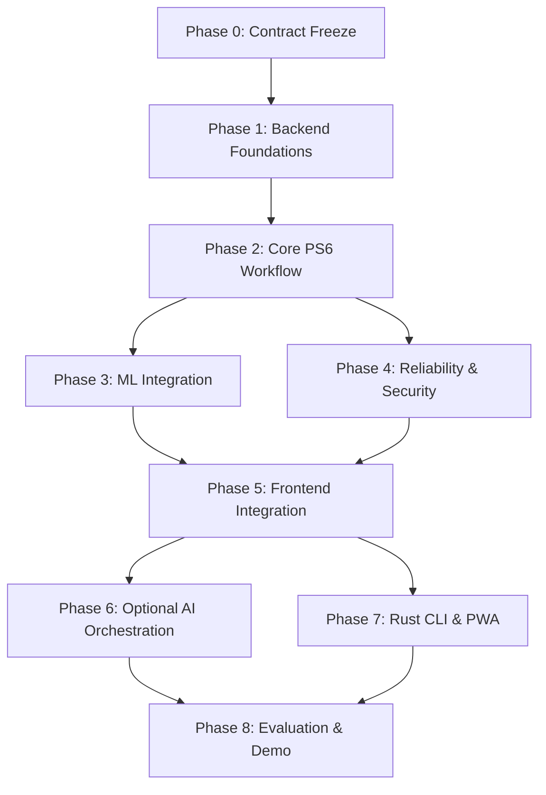
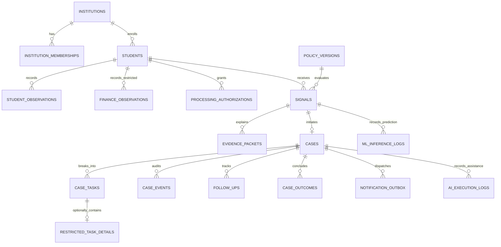
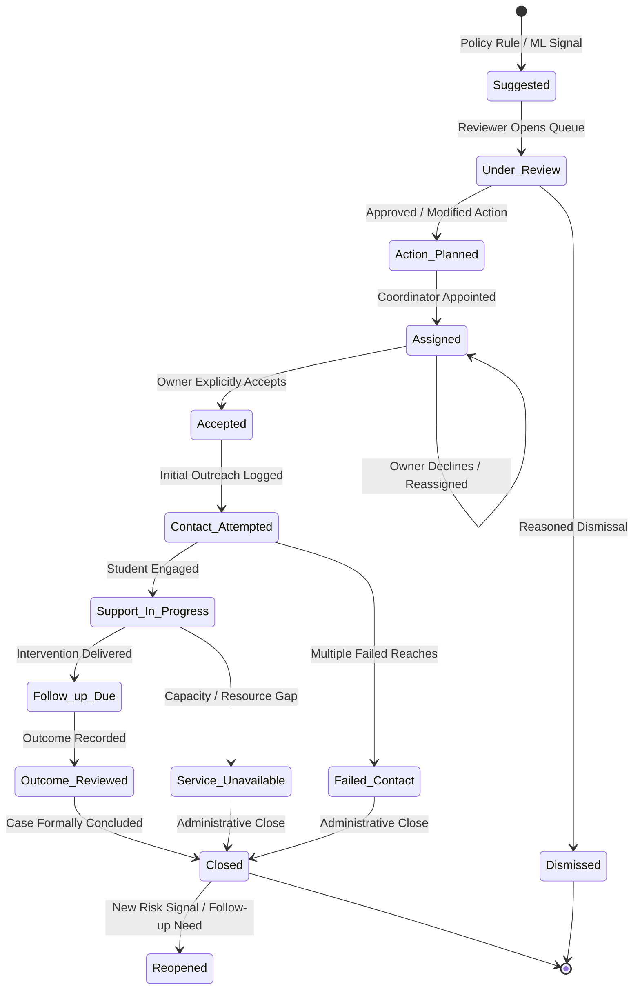
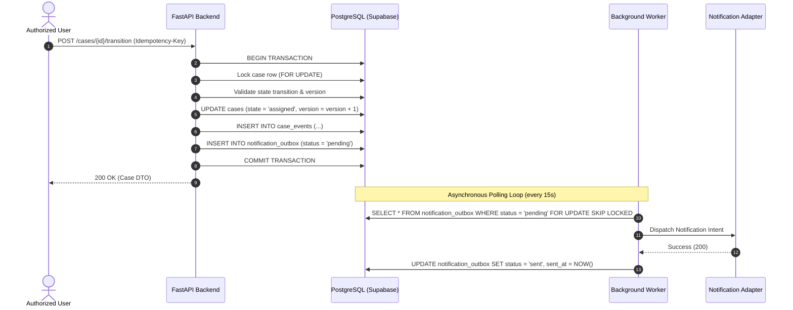

# SUTRA Backend Implementation Pack

**Team:** Overclocked · **Challenge:** CODEX 3.0 / PS6 · **Version:** 2.0 (Reconciled & Canonical) · **Basis date:** 12 October 2026

SUTRA (**Student Success and Intervention Orchestration Engine**) connects multi-source student risk observations to explainable evidence, human review, accountable ownership, enforceable deadlines, verified follow-ups, documented outcomes, and cohort-level operational analytics.

Core product principle:
> **“No Alert Without Action.”**

This canonical master document consolidates all reconciled architecture, data models, API contracts, authorization matrices, temporal anti-leakage safeguards, machine learning boundaries, and phase-wise implementation plans into one single authoritative reference.

---


# 00 · Canonical Phase-Wise Implementation Plan

## 1. Target Outcome

Deliver one coherent, fully auditable, and end-to-end verified implementation of SUTRA:
**Simulated Observations → Deterministic Signal & Evidence Card → Human Review → Assigned Case → Enforceable Due Date & Escalation → Verified Follow-up → Documented Outcome → Cohort Operational Analytics.**

Guided by the non-negotiable principle: **“No Alert Without Action.”**

---

## 2. Canonical Phase Roadmap

| Phase | Phase Name | Primary Deliverables | Strict Exit Gate |
|---|---|---|---|
| **Phase 0** | **Repository Audit & Contract Freeze** | Reconciled documentation, canonical OpenAPI 3.1 contract, verified ML status inventory, architecture decision records. | Zero contradictory documentation; ML artifact vs research status explicitly differentiated; canonical API paths locked. |
| **Phase 1** | **Backend Foundations** | FastAPI application structure, Pydantic v2 schemas, SQLAlchemy 2.x models, Alembic migrations, Supabase JWT verification, campus authorization middleware, `/health` and `/ready` endpoints. | Server-side JWT verification enforced; unauthenticated or cross-campus requests denied; database migrations apply cleanly. |
| **Phase 2** | **Core PS6 Workflow** | Observation ingestion (6 domains), temporal filtering (`available_at <= T`), deterministic policy engine, evidence packet generator, human signal review, case creation, task assignments, follow-ups, outcomes, audit logging. | Complete student support journey executable via REST API; invalid state transitions rejected; sensitive finance/counselling records segregated. |
| **Phase 3** | **ML Integration & Serving** | Isolated `app.ml` internal module invoking `sutra_ml`, Pydantic inference contracts, Day-30 feature extraction, baseline Logistic Regression v1.0.0 (threshold 0.46) loader, research XGBoost containment, Evidence Card generator, compatibility route aliases. | Inference passes all 26 leakage/data-quality tests; missing data handled as `unknown` (never zero); ML predictions produce Evidence Cards and never auto-trigger interventions. |
| **Phase 4** | **Reliability & Security** | Request idempotency middleware (`Idempotency-Key`), PostgreSQL transactional outbox pattern, durable deadline worker, retry backoff, tenant isolation test suite, comprehensive negative authorization matrix. | Idempotent retries produce zero duplicate mutations; worker restart recovers due tasks safely; negative authorization suite passes 100%. |
| **Phase 5** | **Frontend Integration** | Next.js App Router client, React components, Tailwind styling, typed API client integration, authentication state management, educator workflows (Signal Queue, Case Detail, Follow-up Modal, Cohort Dashboard). | End-to-end user workflow functional from browser; UI strictly respects role boundaries; zero sensitive data leaked in client state. |
| **Phase 6** | **Optional AI Orchestration** | Bounded LLM assistance endpoints (`/api/v1/ai/summarize-evidence`, `/api/v1/ai/suggest-intervention`, `/api/v1/ai/draft-followup`), context minimization filters, strict Pydantic output parsing, execution audit logging. | AI operates strictly read-only; zero direct DB mutations; human approval mandatory; system degrades gracefully on provider failure. |
| **Phase 7** | **Rust CLI & PWA Enhancements** | Standalone Rust CLI communicating exclusively via authenticated HTTPS `/api/v1` routes; PWA offline manifest and service worker (strictly omitting sensitive data caching). | CLI respects identical server-side authorization and produces identical audit logs; zero direct database connections. |
| **Phase 8** | **Evaluation & Demonstration** | End-to-end automated acceptance tests, synthetic seed replay script, developer runbook, limitations disclosure, live presentation rehearsal. | Fresh developer can deploy, migrate, seed, and execute complete demo journey without manual database or metrics tampering. |

---

## 3. Strict Dependency Order



### Dependency Rules:
1. **Foundations Before Features:** Phase 1 (Auth, DB models, Alembic) is an absolute blocker for Phase 2. No business route can be created without campus-level authorization.
2. **Deterministic Core Before ML Serving:** Phase 2 (Deterministic signals, human review, cases) must be functional before Phase 3 (ML inference) is wired in. ML provides decision-support evidence to the existing review engine; it does not replace the review engine.
3. **Core Workflow Before Frontend & Tooling:** Phase 5 (Next.js) depends directly on verified APIs from Phases 2, 3, and 4.
4. **Optional Features Deferred:** AI Orchestration (Phase 6), Rust CLI (Phase 7), and PWA enhancements must never block the core PS6 demonstration path.

---

## 4. Definition of Done for Every Phase

Every implementation phase must satisfy all of the following criteria before declaration of completion:
- **Test Automation:** Automated Pytest unit, integration, and security negative tests pass reliably in CI.
- **Contract Adherence:** All input payloads and responses strictly adhere to the canonical OpenAPI 3.1.0 specification.
- **Authorization Enforcement:** Protected operations enforce campus boundary and active role permissions server-side.
- **Data Minimization:** Response DTOs contain only purpose-minimized fields; sensitive finance/counselling payloads are segregated.
- **Audit Logging:** Consequential state changes generate timestamped audit records with actor reference, reason code, and idempotency key.
- **Documentation Parity:** Architecture docs, backlog checklists, and OpenAPI schemas are synchronized with actual code changes.

---

## 5. Scope Fence & Triage Guidelines

- **Must Build (Core PS6 Path):** All 6 observation domains, deterministic policy rules, explainable evidence packets, human review workflow, role-aware assignment, deadlines and escalation, follow-up proof, attributed outcomes, cohort analytics, and non-punitive safeguards.
- **Restricted/Gated Options:** Financial support tasks and counselling referrals require explicit domain capabilities. Adult-student parent contact is strictly non-automated and gated.
- **Explicitly Deferred:** External live SIS/LMS integrations (e.g. EduEagle) without official sandboxes, live autonomous dropout classification, autonomous agentic frameworks, multi-tenant cloud infrastructure guarantees.

### If Schedule Slips:
Preserve: **Campus Authorization → Core Case Lifecycle → Temporal Anti-Leakage → Human Review Audit → Dashboard Correctness**.  
Cut First: Optional AI summarization, Rust CLI, PWA service worker, external webhook notifications, and advanced UI animations.


---


# 01 · Backend Scope and PS6 Traceability

## 1. Product Boundary

SUTRA is the dedicated intervention orchestration layer for CODEX 3.0 (PS6): connecting authorized multi-source observations to explainable evidence, human review, case ownership, enforceable deadlines, verified follow-ups, and recorded outcomes.

It operates strictly on the principle: **“No Alert Without Action.”**

SUTRA is **not** a replacement Student Information System (SIS), a replacement Learning Management System (LMS), an electronic health/clinical record system, an autonomous disciplinary enforcement tool, or an unreviewed black-box dropout classification service.

---

## 2. Requirement-to-Backend Traceability Matrix

| ID | Requirement (PS6 Core Specification) | Canonical Backend Implementation | Verification & Acceptance Evidence |
|---|---|---|---|
| **R1** | Convert early indicators into responsible, trackable support | Deterministic policy evaluation & ML decision support → Human review queue → Persistent case → Follow-up task → Recorded outcome. | Pytest end-to-end journey completes; audit history verifies every transition. |
| **R2** | Consent-aware, purpose-bound 360-degree view | Role-filtered support DTOs generated via Pydantic v2; object-level campus and purpose authorization checks on every read. | Role-switching tests verify unauthorized fields (fees, clinical notes) are omitted from responses. |
| **R3** | Six simulated observation categories (attendance, academic, participation, fees, skills, faculty feedback) | Normalization pipeline ingesting all 6 categories with explicit `event_at`, `available_at`, `ingested_at` timestamps and quality flags. | Ingest all 6 domains; verify data segregated correctly (general observations vs restricted finance observations). |
| **R4** | Explainable early-risk indicators | Versioned deterministic policy engine + internal `sutra_ml` inference generating Evidence Cards (probability, threshold 0.46, top SHAP attributions). | Replay frozen evidence snapshot; verify identical explanation; verify missing data produces `unknown`. |
| **R5** | Intervention recommendations from controlled catalogue | Controlled `intervention_catalog` table with domain-specific templates; human reviewer approves, modifies, or declines recommendations. | Reviewer modifies recommended tutoring to mentor check-in; case created with updated selection and audit reason. |
| **R6** | Accountable assignment across campus roles | Explicit role-aware assignments (faculty, HOD, mentor, counsellor, placement, finance); assignment and acceptance tracked as distinct states. | Assignee receives case in pending queue; accepts responsibility; timestamped acceptance recorded. |
| **R7** | Deadlines and automated escalation | Configurable due dates (`due_at`), PostgreSQL transactional outbox, durable background worker scanning overdue tasks. | Advance virtual demo clock past deadline; worker scans and issues single idempotent escalation event. |
| **R8** | Outcome notes showing whether an intervention helped | Dedicated `case_outcomes` record capturing `helped`, `not_helped`, `mixed`, or explicit `unknown` with follow-up window and rationale. | Record outcome; verify unknown outcomes stay in denominators and are not dropped from reporting. |
| **R9** | Leadership cohort trends & operational analytics | Denominator-defined operational metrics (`GET /api/v1/analytics/overview`) with small-cell suppression (<5) for privacy protection. | Aggregate counts reconcile directly to case and outcome rows; small cohorts marked `suppressed: true`. |
| **R10** | Role-based privacy & domain separation | FastAPI dependency injection enforcing Supabase JWT claims, active campus membership, object-level RBAC, and separate finance tables. | Comprehensive negative test suite (10 test cases) verifies 401/403/404 responses. |
| **R11** | Transparent manual override | Reasoned override operations (`POST /cases/{id}/override`) requiring actor rationale and preserving complete prior decision history. | Execute override; inspect case history to verify previous decision and new decision coexist with timestamps. |
| **R12** | Non-punitive & non-diagnostic invariant | API schemas omit disciplinary actions; rules prohibit inferring psychological conditions; parent contact for adult students strictly gated. | Negative test verifies attempts to execute disciplinary or diagnostic payloads return 422 Unprocessable Entity. |
| **R13** | Action-first orchestration (not a passive dashboard) | The core application state machine revolves around the case lifecycle; alerts cannot exist without assigned reviews. | Inspection of API surface proves every signal requires human triage to avoid backlog accumulation. |
| **R14** | Accountable follow-up tracking | Follow-up tracking distinguishes `contact_attempted`, `student_reached`, and `support_delivered` with explicit proof kinds. | Attestation of contact attempt does not transition case to support completed. |
| **R15** | Unified traceability linking observations to outcomes | Foreign-key lineage connecting observation IDs → evidence packet → signal → case → tasks → follow-ups → outcome. | Querying `/api/v1/cases/{caseId}/history` returns the complete chronological provenance graph. |
| **R16** | EduEagle reference integration boundary | Neutral import contract (`POST /api/v1/imports`) mapping CSV/JSON exports; live integration deferred pending authentic API sandbox. | Import synthetic data via standard schema; verify ingestion batch counts and row-level error reporting. |
| **R17** | Technology stack & advanced differentiators | Python FastAPI modular monolith + Next.js App Router client; co-located `sutra_ml`; optional bounded AI orchestration; future Rust CLI. | Modular architecture passes all unit/integration tests without external distributed broker dependencies. |

---

## 3. In Scope for Implementation

- **Campus & Tenant Boundary:** Every institution-owned entity carries `institution_id` (campus boundary); enforced at the database and application levels.
- **Six Simulated Observation Categories:** Validated, normalized, timestamped, and deduplicated.
- **Deterministic Policy Engine:** Pure, versioned evaluator producing reproducible evidence packets.
- **ML Subsystem Integration:** Co-located `sutra_ml` inference service generating standardized Evidence Cards for Day-30 academic early-warning predictions.
- **Human Case Review & Lifecycle:** 10-state machine covering creation, assignment, explicit acceptance, tasks, follow-ups, outcomes, overrides, and reopenings.
- **Durable Worker & Outbox:** PostgreSQL transactional outbox pattern handling deadline tracking and retries.
- **Cohort Operational Analytics:** Denominator-defined rates and small-cell privacy suppression.

---

## 4. Explicitly Out of Scope

- **Autonomous Dropout Classification:** ML models directly triggering interventions or contacting students without human review.
- **Automatic Parent/Guardian Outreach:** Parent notification without case-specific institutional authorization and adult-student policy compliance.
- **Clinical Psychological Diagnostics:** Any attempt to classify student mental health conditions from engagement or academic data.
- **Live EduEagle Cloud Connection:** Connecting to live production systems without official schemas, sandbox environments, and security clearance.
- **Multi-Agent Autonomous LLM Networks:** Multi-agent swarms with direct database write permissions.
- **Causal Efficacy Claims:** Claiming that correlation metrics (e.g. historical OULAD ROC-AUC) or synthetic demo results prove real-world retention uplift.

---

## 5. Non-Functional Requirements

- **Correctness & Reproducibility:** Replaying frozen evidence against an immutable policy version produces identical outputs.
- **Temporal Anti-Leakage:** Observations available after decision cutoff $T$ (`available_at > T`) are strictly excluded from evaluations.
- **Security & Privacy:** Server-side JWT validation, object-level access checks, zero service-role keys in clients, sanitized logs.
- **Idempotency & Concurrency:** Consequential mutations require `Idempotency-Key`; duplicate submissions return identical cached responses without duplicate effects.
- **Auditability:** Complete actor, timestamp, reason, and before/after state captures for all case transitions.


---


# 02 · Canonical Backend Architecture

## 1. Architectural Strategy

SUTRA is architected as an **asynchronous Python / FastAPI modular monolith** co-locating business workflows, deterministic policy evaluation, transactional case management, and machine learning inference within a single, highly performant process.

Persistence and identity are managed via **PostgreSQL and Supabase Auth**, with server-side JWT verification and object-level authorization enforced on every protected request.

User interfaces interact with the backend as decoupled clients:
- **Primary Web Client:** Next.js (App Router), React, TypeScript, Tailwind CSS. Responsive web application first; progressive web app (PWA) offline enhancements added once the core workflow stabilizes.
- **Future CLI Client:** High-performance Rust CLI communicating exclusively over authenticated HTTPS `/api/v1` routes; zero direct database connections or permission bypasses.

---

## 2. Canonical System Architecture

```mermaid
flowchart TD
  subgraph Clients [Client Tier]
    W[Next.js App Router Web UI]
    C[Future Rust CLI]
  end

  subgraph FastAPI_Server [SUTRA FastAPI Modular Monolith]
    R[FastAPI Route Handlers /api/v1]
    
    subgraph Security_Layer [Security & Context Middleware]
      JWT[Supabase JWT Verification]
      CAMPUS[Campus Context & Membership Resolver]
      AUTHZ[Object-Level RBAC & Purpose Checker]
    end

    subgraph Business_Modules [Internal Application Modules]
      INGEST[Ingestion & Temporal Normalization]
      POLICY[Deterministic Policy Evaluator]
      CASE[Case Lifecycle & State Machine]
      ANALYTICS[Cohort & Operational Analytics]
      AI[Bounded AI Orchestrator (Optional)]
    end

    subgraph ML_Subsystem [Co-located ML Module app.ml]
      ML_VAL[Feature Schema Validation]
      ML_INF[Logistic Regression v1.0.0 Engine]
      ML_EXP[SHAP Explainability & Evidence Card]
    end

    subgraph Async_Worker [Durable Background Execution]
      OUTBOX[Transactional Outbox Table]
      WORKER[Durable Deadline & Escalation Worker]
      NOTIF[Notification Intent Dispatcher]
    end
  end

  subgraph Data_Tier [Persistence & Identity Tier]
    SUPA_AUTH[Supabase Auth Service]
    PG[(PostgreSQL Database via Supabase)]
  end

  W -->|HTTPS /api/v1 Bearer JWT| R
  C -->|HTTPS /api/v1 Bearer JWT| R

  R --> JWT
  JWT -->|Verify Signature| SUPA_AUTH
  JWT --> CAMPUS
  CAMPUS --> AUTHZ
  AUTHZ --> Business_Modules

  POLICY --> PG
  CASE --> PG
  INGEST --> PG
  ANALYTICS --> PG

  POLICY -.->|Invoke when eligible| ML_Subsystem
  ML_Subsystem -->|Feature extraction| PG
  ML_Subsystem -->|Evidence Card output| CASE

  AI -.->|Read-only context| PG
  AI -.->|Structured drafts| CASE

  CASE -->|Atomic transaction| OUTBOX
  WORKER -->|Poll due deadlines| PG
  WORKER -->|Process intents| OUTBOX
  WORKER --> NOTIF
```

---

## 3. Core Internal Modules

1. **`app.core.security` (Identity & Authorization):**
   - Validates incoming Supabase Bearer JWTs server-side using server-held cryptographic secrets (`SUPABASE_JWT_SECRET`).
   - Resolves active campus membership and role capabilities from `institution_memberships`.
   - Rejects unauthenticated, cross-campus, or unauthorized operations at the dependency injection level.
2. **`app.modules.ingestion` (Ingestion & Temporal Integrity):**
   - Ingests CSV/JSON observation batches across all 6 categories (attendance, academic, participation, fees, skills, faculty feedback).
   - Validates schemas, enforces deduplication, isolates restricted finance records, and validates temporal timestamps (`event_at`, `available_at`, `ingested_at`).
3. **`app.modules.policy` (Deterministic Policy Engine):**
   - Pure, deterministic evaluator operating over frozen evidence snapshots (`as_of_at`).
   - Evaluates versioned, immutable rule sets (`policy_versions`) producing reproducible signal evaluations and evidence packets.
4. **`app.ml` (Co-located ML Module):**
   - Interfaces directly with the Python package `sutra_ml` in-process.
   - Validates incoming feature vectors against Day-30 OULAD snapshot schemas (25 features).
   - Serves the **Regularized Logistic Regression v1.0.0** baseline at decision threshold **0.46**.
   - Contains the **Constrained XGBoost** candidate as research-only.
   - Formats outputs as standardized **Evidence Cards** with probability, threshold, and feature attributions.
5. **`app.modules.cases` (Case Lifecycle & Task Management):**
   - Enforces the strict 10-state case lifecycle state machine (`Suggested` → `Under Review` → `Action Planned` → `Assigned` → `Accepted` → `Contact Attempted` → `Support In Progress` → `Follow-up Due` → `Outcome Reviewed` → `Closed`).
   - Handles primary coordinator assignment, explicit owner acceptance, domain subtasks, follow-up records, and outcome notes.
6. **`app.modules.worker` (Durable Worker & Outbox):**
   - Executes durable asynchronous deadline scanning and notification dispatch via the PostgreSQL transactional outbox.
   - Bounded retries with exponential backoff; zero dependency on external message brokers (Redis/RabbitMQ).
7. **`app.modules.analytics` (Cohort & Operational Analytics):**
   - Computes denominator-defined operational metrics (acceptance rate, first-contact coverage, outcome-known rate).
   - Enforces small-cell privacy suppression (<5 students) on sensitive cohort queries.
8. **`app.modules.ai` (Bounded AI Orchestrator - Optional):**
   - Optional, bounded helper endpoints for evidence summarization, catalogue-restricted intervention suggestion, and outreach note drafting.
   - Strictly read-only; zero direct database mutation permissions.

---

## 4. Protected Request Flow

Every incoming mutation or sensitive read executes through this rigorous pipeline:
1. **Schema Validation:** FastAPI / Pydantic v2 validates request body, parameter types, string lengths, and payload size.
2. **JWT Authentication:** Dependency `get_current_user` extracts Bearer JWT, validates signature, expiration, and issuer.
3. **Campus Context Resolution:** Dependency `get_campus_membership` resolves active user membership within the target institution. Client-supplied roles or campus IDs in request bodies are ignored.
4. **Object-Level Authorization:** Data Access Layer (DAL) verifies that requested student, case, or task belongs to the user's active campus and that the user's role permits the specific action.
5. **Domain & Purpose Verification:** If the operation touches sensitive domains (e.g. fees, counselling), the system verifies explicit domain capabilities (`finance`, `counsellor`) and active student processing authorization.
6. **Atomic Transactional Mutation:** State change, lifecycle event, audit record, and outbox intent commit together in a single PostgreSQL transaction or rollback entirely on failure.
7. **Purpose-Minimized DTO Serialization:** Response is filtered through explicit Pydantic DTO schemas; raw database rows and sensitive fields are never returned to unauthorized callers.
8. **Sanitized Audit Logging:** Request ID, execution time, and sanitized audit codes are logged; zero student PII, finance notes, or clinical details are emitted.

---

## 5. ML Deployment Boundary & Co-location Justification

### Co-location Architecture
The ML package (`sutra_ml`) runs inside the FastAPI process. This architectural choice is deliberate:
- **Low Latency:** Zero inter-process network overhead or serialization delays when scoring students and assembling Evidence Cards.
- **Unified Language Stack:** FastAPI and `sutra_ml` both run on Python 3.10+, utilizing shared dependencies (`pydantic`, `numpy`, `pandas`).
- **Operational Simplicity:** Single container deployment, simplified environment configuration, and unified CI/CD pipelines.

### Criteria for a Future Microservice Split
The ML subsystem will only be separated into an independent microservice if one of the following concrete conditions is met:
1. **Hardware Acceleration:** High-volume inference requires dedicated GPU or high-compute instances that would be inefficient for the general CRUD API.
2. **Independent Scaling:** Inference workload volume significantly diverges from CRUD case management traffic.
3. **Dependency Conflict:** Advanced deep-learning or AutoML libraries introduce unresolvable C-library or Python package version collisions with core backend dependencies.
4. **Team Ownership Boundaries:** A dedicated ML engineering team requires isolated deployment cadence without risking backend API regressions.

---

## 6. Asynchronous Execution: PostgreSQL Outbox vs Distributed Broker

SUTRA utilizes the **PostgreSQL Transactional Outbox Pattern** for all asynchronous work:
- Consequential mutations write a pending record to `notification_outbox` within the same database transaction as the state mutation.
- A lightweight background worker (FastAPI lifespan task or dedicated worker process) polls `notification_outbox` and scans overdue cases using row-level locking (`FOR UPDATE SKIP LOCKED`).
- **No Redis / RabbitMQ Requirement:** Adding an external message broker adds operational failure modes (broker crashes, split-brain, lost transactions, outbox dual-write failures). PostgreSQL provides ACID transactional guarantees out of the box.

---

## 7. Client Boundaries: Next.js Frontend & Rust CLI

- **Next.js Frontend:** Interacts with the backend exclusively via standard HTTP Bearer token requests. The Next.js client does not hold database service-role secrets and does not directly connect to PostgreSQL.
- **Rust CLI (Future):** Designed for high-throughput batch operations and administrator inspection. The CLI must authenticate using user credentials, receive a Supabase JWT, and call the FastAPI REST API. The CLI is strictly forbidden from bypassing server-side authorization or establishing direct SQL connections to Supabase.


---


# 03 · Data Model, SQLAlchemy 2.x Schemas & Migrations

## 1. Modeling Principles

- **Tenant / Campus Isolation:** Every institution-owned table includes `institution_id` (representing the campus boundary). Multi-campus queries are partitioned at the database level.
- **Separation of Concerns:** Raw observations, deterministic rules, derived signals, reviewed cases, subtasks, follow-up proof, and final outcomes reside in decoupled, normalized tables.
- **Sensitive Domain Segregation:** Sensitive financial observations (`finance_observations`) and confidential task details (`restricted_task_details`) are physically separated into dedicated tables. They are never joined into broad default views.
- **Strict Temporal Distinction:** `event_at` (when occurrence happened), `available_at` (when data became visible to decision makers), `ingested_at` (when system wrote record), and `decision_at` (when rule/model ran) are distinct, immutable timestamps.
- **Retention & Provenance:** Decisions link directly to immutable `policy_versions` and frozen `evidence_packets`.

---

## 2. Entity Relationships (ERD)



---

## 3. Core Database Tables & Data Dictionary

| Table Name | SQLAlchemy Model | Purpose & Description | Key Constraints & Invariants |
|---|---|---|---|
| `institutions` | `Institution` | Campus / tenant entity. | `id` UUID PK, `status` ('active', 'disabled'). |
| `institution_memberships` | `InstitutionMembership` | User role mapping within campus. | Unique `(institution_id, user_id, role)`. Active flag. |
| `students` | `Student` | Pseudonymous student identity and cohort. | Unique `(institution_id, external_ref)`. `enrollment_status`. |
| `processing_authorizations` | `ProcessingAuthorization` | Purpose-bound consent/policy basis. | Unique `(student_id, purpose_key)`. Status, validity dates. |
| `source_imports` | `SourceImport` | Batch upload record for CSV/JSON. | Unique `(institution_id, digest)`. Accepted/error row counts. |
| `student_observations` | `StudentObservation` | General observations (5 categories). | Unique `(institution_id, student_id, domain, metric_key, event_at)`. |
| `finance_observations` | `FinanceObservation` | Restricted fee-support observations. | Isolated table. Role `finance` required. |
| `policy_versions` | `PolicyVersion` | Immutable deterministic rule sets. | Unique `(policy_key, version)`. Checksum digest. |
| `evidence_packets` | `EvidencePacket` | Frozen snapshot of observations at cutoff. | `as_of_at` timestamp, JSONB snapshot, SHA256 digest. |
| `signals` | `Signal` | Evaluated risk alert and evidence link. | Unique `(student_id, policy_version_id, as_of_at)`. Quality state. |
| `intervention_catalog` | `InterventionCatalog` | Controlled menu of support actions. | `intervention_key` PK, domain, target roles, approval flag. |
| `cases` | `Case` | Coordination unit for student support. | Unique `(signal_id)`. Optimistic locking `version`. State enum. |
| `case_tasks` | `CaseTask` | Deliverable domain subtask. | Generic labels, due dates, assignee, completion status. |
| `restricted_task_details` | `RestrictedTaskDetail` | Sensitive finance/counselling payload. | FK to `case_tasks`. Strict purpose & capability check. |
| `case_events` | `CaseEvent` | Append-only audit history of transitions. | Actor ID, event type, before/after states, reason code. |
| `follow_ups` | `FollowUp` | Evidence of contact and support delivery. | `contact_status`, `proof_kind`, occurred timestamp, note. |
| `case_outcomes` | `CaseOutcome` | Attributed post-support result. | `outcome_status` ('helped', 'not_helped', 'mixed', 'unknown'). |
| `notification_outbox` | `NotificationOutbox` | Transactional outbox for worker dispatch. | Status, retry count, next attempt time, idempotency key. |
| `ml_inference_logs` | `MLInferenceLog` | Serving audit for ML model predictions. | Model name, version (v1.0.0), probability, threshold (0.46), SHAP attributions. |
| `ai_execution_logs` | `AIExecutionLog` | Execution audit for optional LLM runs. | Feature key, prompt token count, latency, human approval status. |

---

## 4. Controlled Enumerations & Values

- **Campus Roles:** `faculty`, `hod`, `mentor`, `counsellor`, `placement`, `finance`, `leadership`, `institution_admin`.
- **Observation Domains (General):** `attendance`, `academic`, `participation`, `skills`, `faculty_feedback`.
- **Restricted Domains:** `finance`, `counselling`, `parent_contact_review`.
- **Signal Results:** `attention_suggested`, `no_rule_triggered`, `unknown`.
- **Quality States:** `sufficient`, `insufficient_evidence`, `stale_source`, `conflicting_source`, `missing_denominator`.
- **Review Decisions:** `approve`, `modify`, `dismiss`, `request_more_data`.
- **Case Lifecycle States:** `suggested`, `under_review`, `action_planned`, `assigned`, `accepted`, `contact_attempted`, `support_in_progress`, `follow_up_due`, `outcome_reviewed`, `closed`, `dismissed`, `student_declined`, `service_unavailable`, `failed_contact`, `referred`, `reopened`.
- **Proof Kinds:** `staff_attestation`, `student_confirmation`, `system_event`, `document_reference`.
- **Outcome Statuses:** `helped`, `not_helped`, `mixed`, `unknown`.

---

## 5. Indexes, Integrity Constraints & Alembic Migration Strategy

### Indexes for High-Frequency Query Paths:
1. `idx_memberships_user_active`: `(user_id, is_active, institution_id)`
2. `idx_students_cohort`: `(institution_id, cohort_code, enrollment_status)`
3. `idx_observations_lookup`: `(institution_id, student_id, domain, available_at)`
4. `idx_signals_queue`: `(institution_id, result, created_at)`
5. `idx_cases_due_queue`: `(institution_id, current_state, due_at)`
6. `idx_outbox_pending`: `(status, next_attempt_at) WHERE status IN ('pending', 'failed')`

### Alembic Migration Sequence:
- `001_initial_core_schema.py`: Tables, foreign keys, check constraints, and performance indexes.
- `002_rls_policies_and_grants.py`: Explicit PostgreSQL Row Level Security policies and role-based grants.
- `003_ml_and_ai_audit_tables.py`: `ml_inference_logs` and `ai_execution_logs` tables.
- All migrations must support deterministic rollback (`downgrade()`) and include unit tests validating schema upgrades.


---


# 04 · Authorization, Campus Privacy & Security Controls

## 1. Identity & Campus Membership Model

Authentication establishes verified user identity; authorization strictly dictates permitted resources, domains, and operations.

SUTRA integrates **Supabase Auth**, but enforces all authorization **server-side** inside the FastAPI application:
1. **Server-Side Cryptographic JWT Verification:** Every protected request carries a Bearer JWT in the `Authorization` header. FastAPI dependency `get_current_user` validates signature, expiration, and issuer using server-held `SUPABASE_JWT_SECRET`. Client-supplied roles or identity claims in JSON bodies are completely ignored.
2. **Campus Membership Resolution:** FastAPI dependency `get_campus_membership` queries `institution_memberships` using the authenticated `user_id`. It confirms active status (`is_active = true`) within the target `institution_id` (campus boundary).
3. **Data Access Layer (DAL) Object Checks:** Even with a valid token and active membership, the DAL verifies object-level ownership: the student, signal, case, or task must belong to the user's active campus, and the user's role must permit the requested operation.

### Canonical Campus Roles:
`faculty`, `hod`, `mentor`, `counsellor`, `placement`, `finance`, `leadership`, `institution_admin`.

---

## 2. Role-Based Capability Matrix

| Data / Action | Faculty | HOD | Mentor | Counsellor | Placement | Finance | Leadership | Admin |
|---|---|---|---|---|---|---|---|---|
| **Academic Observations** | Scoped | Scoped | Assigned | Referral context only | Referral context only | No | Aggregates only | Config only |
| **Fee Details** | No | No by default | No | No | No | Authorized finance tasks | Aggregates only | No elevated data access |
| **Counselling Details** | No | No | Referral status only | Authorized cases only | No | No | Aggregates only | No elevated data access |
| **Submit Observation / Concern** | Yes | Yes | Yes | Role scope | Role scope | Role scope | No by default | No |
| **Review & Approve Signal** | Scoped | Yes | Assigned scope | Counselling referrals only | Placement support only | Finance support only | No | Emergency override only |
| **Assign / Reassign Owner** | Limited | Yes | Assigned scope | Domain tasks | Domain tasks | Domain tasks | Operational aggregates | Configuration, audited |
| **Record Follow-Up Proof** | Assigned cases | Assigned cases | Assigned cases | Counselling tasks | Placement tasks | Finance tasks | No | No |
| **Record Student Outcome** | Assigned cases | Yes | Assigned cases | Counselling tasks | Placement tasks | Finance tasks | No | No |
| **Cohort Aggregates** | Course scope | Yes | Mentee scope | Domain scope | Domain scope | Domain scope | Yes (suppressed <5) | Yes |
| **Manual Override** | Reasoned own case | Yes | Assigned scope | Domain scope | Domain scope | Domain scope | No | Governed audit |

---

## 3. Four-Dimensional Authorization Model

Every protected operation evaluates across four distinct dimensions:
1. **Campus / Institution Boundary:** Active membership in the target `institution_id`. Cross-campus access is strictly forbidden and returns an indistinguishable `404 Not Found`.
2. **Role & Capability:** User's assigned role possesses explicit permission for the requested action under the capability matrix.
3. **Domain Boundary:** Sensitive financial data (`finance_observations`) and counselling notes (`restricted_task_details`) require explicit domain authorization. General case queries omit sensitive payloads.
4. **Purpose & Student Processing Authorization:** Processing must be valid under an active `processing_authorizations` record. Withdrawn optional authorization immediately halts pending optional workflows.

---

## 4. DTO Serialization & Logging Privacy Rules

- **Strict Field Allow-Lists:** FastAPI / Pydantic v2 response schemas use strict field allow-lists. Raw database models are never returned to clients.
- **DTO Redaction:** Mentors and general faculty inspecting a case with financial support tasks receive only generic task labels (e.g. `domain: "finance"`, `status: "in_progress"`). The fee amount, debt status, and private notes are completely stripped.
- **Aggregates-Only for Leadership:** Leadership accounts receive aggregated operational metrics; they are denied access to identifiable individual student queues.
- **Small-Cell Suppression:** Any cohort aggregate query returning fewer than `SUTRA_MIN_AGGREGATE_CELL` (default: 5) individuals is redacted and marked `suppressed: true` to prevent re-identification.
- **Log Sanitization:** Application logs, error traces, and metrics strictly exclude student names, roll numbers, fee balances, counselling notes, JWT tokens, and LLM student prompts.

---

## 5. Database Safeguards & RLS Defense-in-Depth

- **Dual-Layer Enforcement:** Table grants and PostgreSQL Row Level Security (RLS) policies are configured in tandem.
- **Service-Role Isolation:** The Supabase secret/service-role key (`SUPABASE_SERVICE_ROLE_KEY`) bypasses RLS and is strictly confined to the backend server environment. It is never exposed to Next.js browser bundles, mobile clients, or the Rust CLI.
- **Worker Isolation:** Asynchronous workers operate with isolated, least-privilege credentials restricted to due task queries and outbox dispatch.

---

## 6. Ten Must-Pass Security Negative Tests

1. `test_anonymous_request_rejected`: Unauthenticated request returns `401 Unauthorized`.
2. `test_inactive_membership_rejected`: User with `is_active = false` returns `403 Forbidden`.
3. `test_cross_campus_access_blocked`: User attempting to access student or case from another campus returns `404 Not Found` (zero disclosure).
4. `test_mentor_cannot_read_fee_details`: Mentor requesting `/students/{id}/finance` returns `403 Forbidden`; general DTO omits fee fields.
5. `test_faculty_cannot_perform_counsellor_action`: Faculty submitting counselling referral outcome returns `403 Forbidden`.
6. `test_leadership_cannot_list_identifiable_cases`: Leadership role requesting `/cases` returns `403 Forbidden`.
7. `test_spoofed_role_in_payload_ignored`: Request containing `{"role": "institution_admin"}` does not elevate authority.
8. `test_revoked_purpose_blocks_handoff`: Withdrawn student processing authorization halts optional intervention creation.
9. `test_service_key_absent_from_client_bundles`: Automated build scanner verifies `SUPABASE_SERVICE_ROLE_KEY` is nowhere in client code.
10. `test_small_cell_suppression_enforced`: Query for cohort with $N=3$ students returns masked metrics and `suppressed: true`.

---

## 7. Safeguarding & Non-Punitive Invariant

SUTRA is engineered strictly as an educational support and early-warning orchestration system:
- **No Disciplinary Sanctions:** SUTRA contains zero endpoints, rules, or workflows for suspending students, issuing penalties, or recording disciplinary sanctions.
- **No Psychological Diagnosis:** Under no circumstances may rule engines, ML models, or AI summaries output clinical psychological labels (e.g. "depressed", "bipolar").
- **Adult Student Privacy:** Parent/guardian contact for adult students is strictly non-automated and gated behind mandatory human review and institutional privacy policy compliance.


---


# 05 · Ingestion, Data Quality, and Temporal Integrity

## 1. Multi-Source Ingestion Boundary

SUTRA ingests observations across the six PS6 educational categories:
1. **Attendance:** Class/session attendance ratios, absences, and date ranges.
2. **Academic Performance:** Assignment submissions, assessments, and grade release indicators.
3. **Engagement / LMS Activity:** Virtual Learning Environment (VLE) interactions, active study days, and recency.
4. **Fee Support (Restricted):** Institutional fee clearance and financial aid status (segregated in `finance_observations`).
5. **Skills & Competencies:** Rubric-assessed practical milestones and competency levels.
6. **Faculty Feedback:** Structured qualitative concerns submitted by course instructors.

All sources ingest through neutral CSV/JSON schema contracts (`POST /api/v1/imports`). External LMS/SIS connectors (e.g. EduEagle) map directly into this normalized internal representation.

---

## 2. Normalized Observation Contract

```json
{
  "institution_id": "00000000-0000-4000-8000-000000000001",
  "external_student_ref": "SYN-1007",
  "domain": "academic",
  "metric_key": "assessment_submission_count",
  "value": 3.0,
  "unit": "count",
  "quality_state": "sufficient",
  "event_at": "2026-10-02T14:30:00Z",
  "available_at": "2026-10-03T09:00:00Z",
  "source_system": "canvas_lms_v2",
  "source_record_ref": "sub_98124"
}
```

---

## 3. The Four Critical Timestamps (Anti-Leakage Safeguards)

To eliminate data leakage, SUTRA enforces strict separation between four distinct timestamps:
- `event_at`: The exact UTC timestamp when the underlying physical event occurred (e.g., student submitted assignment, class was held).
- `available_at`: The exact UTC timestamp when the record became available to decision-makers or the system (e.g., instructor published grades, attendance register was finalized).
- `ingested_at`: The exact UTC timestamp when SUTRA received and persisted the record (set server-side; cannot be backdated).
- `decision_at`: The exact UTC timestamp when a policy rule evaluation or ML inference run was executed.

> [!CRITICAL]
> **Temporal Integrity Rule:** An observation is eligible for an evaluation as-of cutoff $T$ **if and only if `available_at <= T`**.  
> If `available_at` is unrecorded or unknown, the system must treat the data as indeterminate and must **never** silently substitute `event_at`.

---

## 4. The 2026 OULAD Leakage Finding & Architectural Response

Recent educational data mining literature demonstrates that published models evaluated on the Open University Learning Analytics Dataset (OULAD) suffered from severe **future-information leakage**:
1. Evaluating VLE clicks or assessment grades recorded *after* the early-warning prediction window ($t > 30$).
2. Including post-cutoff course withdrawal dates (`date_unregistration > 30`) as predictors.
3. Leaking assessment feedback scores that were graded weeks after the prediction cutoff.

### SUTRA's Verified Safeguards:
- **Hard Temporal Cutoff:** All 10.6M raw VLE interaction logs are chunk-filtered at $t \le 30$ days before feature aggregation.
- **Score Exclusion:** While early assessment submissions (`date_submitted <= 30`) are counted, scores are excluded because OULAD records no grade publication timestamp (`date_graded`). Assuming instant grade availability leaks future feedback.
- **Pre-Cutoff Cohort Filtering:** Students who withdrew before Day 30 ($t \le 30$) are completely excluded from the prediction population to prevent survivor bias.

---

## 5. Missing Data Policy: Never Impute Silent Zeroes

A fundamental product rule of SUTRA is:
> **Missing or stale data equals `unknown` or `insufficient_evidence` — NEVER a silent zero.**

- If attendance logs have not synced for 14 days, the student's status is `stale_source` or `insufficient_evidence`. It must **never** be imputed as 0% attendance.
- If a student has zero clicks because the LMS tracking was offline, the system marks the indicator as `quality_state: missing`.
- Rules requiring missing evidence return `unknown`, prompting human educators to investigate data connectivity before jumping to adverse student conclusions.

---

## 6. Import Pipeline Execution & Error Handling

1. **Batch Receipt:** `POST /api/v1/imports` creates a `source_imports` row with SHA256 payload digest.
2. **Schema & Range Validation:** Validates domains, units, numeric bounds, and date chronology (`event_at <= available_at`).
3. **Student Reference Resolution:** Matches `external_student_ref` within the campus. Unmatched references generate row errors (`UNKNOWN_STUDENT_REFERENCE`); real student records are never auto-created from unverified imports.
4. **Deduplication:** Dedupes rows using unique key `(institution_id, source_system, source_record_ref)`.
5. **Transactional Persistence:** Valid rows are inserted; invalid rows are recorded in `source_imports.error_details`.
6. **Status Finalization:** The batch completes as `completed`, `completed_with_errors`, or `failed`.


---


# 06 · Versioned Policy Engine, Evidence Packets & ML Evidence Cards

## 1. Hybrid Policy Evaluation Strategy

SUTRA combines **transparent deterministic rules** with **bounded ML early-warning indicators**:
1. **Deterministic Policies (Core Alert Engine):** Rule-based evaluations authored by institutional experts that evaluate student observations against configured academic thresholds.
2. **Machine Learning Model (Decision-Support Signal):** Evaluated strictly when the student's available observations satisfy the Day-30 feature contract. The ML output is formatted as a standardized **Evidence Card** attached to the signal review queue.

> **Principle:** A rule or model probability identifies a situation requiring human attention. It does not explain personal circumstances, diagnose a student, or guarantee failure.

---

## 2. Pure Policy Evaluator Contract (Python / Pydantic v2)

```python
class PolicyEvaluationRequest(BaseModel):
    institution_id: UUID
    external_student_ref: str
    policy_version_id: UUID
    as_of_at: datetime
    authorized_observations: list[ObservationDTO]
    quality_summary: QualitySummaryDTO

class TriggeredRule(BaseModel):
    rule_key: str
    rationale_code: str
    evidence_refs: list[str]
    observed_values: dict[str, Any]
    suggested_interventions: list[str]

class PolicyEvaluationResult(BaseModel):
    result: Literal["attention_suggested", "no_rule_triggered", "unknown"]
    quality_state: Literal["sufficient", "insufficient_evidence", "stale_source", "conflicting_source"]
    triggered_rules: list[TriggeredRule]
    missing_or_stale_domains: list[str]
    explanation_template_key: str
```

The evaluator is **pure, deterministic, and side-effect-free**. Given the exact same frozen evidence packet and policy version, it will always output the identical evaluation result.

---

## 3. Machine Learning Evidence Card Output

When the ML pipeline runs, its prediction is packaged into an **Evidence Card** presented to human reviewers:

```json
{
  "card_type": "ml_early_warning_evidence",
  "model_name": "logistic_regression_baseline",
  "model_version": "1.0.0",
  "prediction_cutoff": "Day 30",
  "risk_probability": 0.68,
  "threshold": 0.46,
  "classification": "At_Risk",
  "calibration_status": "platt_calibrated",
  "top_attributions": [
    {"feature": "vle_days_since_last_click", "value": 18.0, "attribution": 0.28, "direction": "increases_risk"},
    {"feature": "vle_clicks_last_7d", "value": 4.0, "attribution": -0.22, "direction": "increases_risk"},
    {"feature": "assessments_submitted_d30", "value": 0.0, "attribution": 0.19, "direction": "increases_risk"}
  ],
  "limitations": [
    "Trained on historical Open University course registrations; not calibrated for non-modular curricula.",
    "Early assessment grades were excluded to avoid temporal leakage.",
    "Represents statistical correlation, not causal certainty or personal diagnosis."
  ]
}
```

---

## 4. Immutable Policy Versions

Every policy is versioned and stored in `policy_versions`:
- `policy_key`: Unique string identifier (e.g. `academic_support_d30`).
- `version`: Monotonically increasing integer.
- `status`: `draft`, `published`, or `retired`.
- `rules_definition`: Validated JSON array of rule predicates and threshold values.
- `evaluator_version`: Code version of the evaluator engine.
- `checksum`: SHA256 digest of the canonical rules definition.

Published versions are **strictly immutable**. Any change to thresholds or rules requires publishing version $N+1$.

---

## 5. Evidence Packet Minimum

Every generated `Signal` links to an immutable `EvidencePacket` containing:
- Frozen observation IDs and source versions available at `as_of_at`.
- Redacted, normalized values required to justify the trigger.
- Explicit freshness, completeness, and missingness metrics.
- SHA256 digest of the evidence payload.
- Approved retention class and scheduled expiration timestamp.

Sensitive financial records and confidential counselling notes are **strictly omitted** from general evidence packets.

---

## 6. Human Review & Reasoned Override Workflow

When an authorized reviewer inspects a signal, four actions are available:
1. **Approve:** Accepts the suggested intervention and moves to case creation.
2. **Modify:** Selects an alternative intervention from the `intervention_catalog` with an explicit reason code (e.g. `REVIEWER_SELECTED_ALTERNATIVE`).
3. **Dismiss:** Closes the signal without case creation, recording actor rationale (e.g. `STUDENT_RESOLVED_EXTERNALLY`).
4. **Request More Data:** Flags the signal for follow-up data collection when evidence is stale or conflicting.

An override **never mutates** the original machine-generated signal; it records a distinct, timestamped `SignalReview` or `CaseEvent` linked to the reviewer's identity.

---

## 7. Replay & Reproducibility Tests

1. `test_deterministic_replay_produces_identical_output`: Re-evaluating the same frozen evidence packet and policy version produces bit-for-bit identical results and explanation codes.
2. `test_late_observations_excluded_from_replay`: Adding an observation with `available_at > as_of_at` does not alter the historical replay.
3. `test_missing_required_metric_yields_unknown`: Evaluating with a missing critical denominator returns `unknown` rather than `no_rule_triggered`.
4. `test_evidence_digest_mismatch_raises_integrity_error`: Tampering with stored evidence packet JSON triggers an audit integrity exception.


---


# 07 · Case Lifecycle, State Machine & Durable Outbox Worker

## 1. Primary Case Lifecycle & State Machine

The core product principle **“No Alert Without Action”** is operationalized through a strict 10-stage primary lifecycle:



---

## 2. Formal Transition Rules & Validations

| From State | Allowed To State | Required Roles | Required Payload Fields | Event Emitted |
|---|---|---|---|---|
| `suggested` | `under_review` | Faculty, HOD, Mentor | `signal_id` | `CASE_REVIEW_STARTED` |
| `under_review` | `action_planned` | Faculty, HOD, Mentor | `selected_intervention_key`, `reason_code` | `INTERVENTION_APPROVED` |
| `under_review` | `dismissed` | Faculty, HOD, Mentor | `dismissal_reason_code`, `rationale` | `SIGNAL_DISMISSED` |
| `action_planned` | `assigned` | HOD, Mentor, Admin | `primary_owner_user_id`, `due_at` | `OWNER_ASSIGNED` |
| `assigned` | `accepted` | Assigned User Only | `acceptance_note` (optional) | `ASSIGNMENT_ACCEPTED` |
| `assigned` | `assigned` (reassign) | HOD, Mentor, Admin | `new_owner_user_id`, `reassignment_reason` | `OWNER_REASSIGNED` |
| `accepted` | `contact_attempted` | Assigned User | `occurred_at`, `proof_kind` | `CONTACT_ATTEMPTED` |
| `contact_attempted` | `support_in_progress`| Assigned User | `contact_status: "student_reached"` | `SUPPORT_STARTED` |
| `contact_attempted` | `failed_contact` | Assigned User | `reason_code`, `attempts_count` | `CONTACT_FAILED` |
| `support_in_progress`| `follow_up_due` | Assigned User | `delivery_proof_ref`, `follow_up_due_at` | `SUPPORT_DELIVERED` |
| `follow_up_due` | `outcome_reviewed` | Assigned User, HOD | `outcome_status`, `rationale` | `OUTCOME_RECORDED` |
| `outcome_reviewed` | `closed` | Assigned User, HOD | `closing_note` | `CASE_CLOSED` |
| `closed` | `reopened` | HOD, Admin | `reopen_reason_code`, `next_action` | `CASE_REOPENED` |

> [!IMPORTANT]
> **No Generic Arbitrary Updates:** There is no generic `PATCH /cases/{id}` endpoint allowing arbitrary state updates. All state mutations must use explicit, transition-specific routes (e.g. `POST /cases/{id}/transition`, `POST /cases/{id}/assignment`, `POST /cases/{id}/accept-assignment`).

---

## 3. Accountable Ownership & Domain Subtasks

- **Single Primary Coordinator:** Every active case has exactly one primary accountable owner (`primary_owner_user_id`) responsible for meeting deadlines.
- **Separation of Assignment and Acceptance:** Assigning an owner does not mean work has started. The owner must explicitly call `/cases/{id}/accept-assignment` to acknowledge responsibility.
- **Domain Subtasks:** Specialized support actions (financial aid, mental health counselling) are spawned as `CaseTask` rows assigned to domain specialists (`finance`, `counsellor`). Sensitive subtask notes are kept in `restricted_task_details`.

---

## 4. PostgreSQL Transactional Outbox Pattern & Background Worker

SUTRA guarantees durable asynchronous execution without external message brokers using the transactional outbox pattern:



### Deadline & Escalation Worker Loop:
1. Scans `cases` where `current_state NOT IN ('closed', 'dismissed') AND due_at < NOW() AND is_escalated = false`.
2. Marks case as `is_escalated = true`.
3. Inserts a `CASE_ESCALATED` event into `case_events`.
4. Inserts a supervisor notification intent into `notification_outbox`.
5. Bounded backoff retry strategy for failed outbox dispatches (max 5 attempts before marking `dead_letter`).

---

## 5. Request Idempotency & Optimistic Concurrency

- **Idempotency-Key Header:** Required on all mutation endpoints. A duplicate request with an identical key within 24 hours returns the cached response without creating duplicate database writes or outbox messages.
- **Optimistic Concurrency Control:** Every case row carries an integer `version`. Mutations supply `version`; if a concurrent update modified the row, a `409 Conflict` (`CONCURRENT_CASE_MODIFICATION`) is raised.

---

## 6. Controlled Demo Clock (Evaluation Runbook)

For testing and demonstration, SUTRA supports a virtual simulation clock (`SUTRA_DEMO_MODE=true`):
- Time provider injects `effective_now` rather than system wall time.
- Allows demonstration of deadline expiration and escalation in seconds without modifying historical event timestamps.
- Disabled in production environments (`ENVIRONMENT=production`).


---


# 08 · Canonical API Contract & OpenAPI Specification

Base Path: `/api/v1`. Format: `application/json`. Charset: UTF-8.  
Every protected route requires `Authorization: Bearer <SUPABASE_JWT>`.

---

## 1. Response Conventions & Standard Error Envelope

- **Purpose-Minimized DTOs:** Responses serialize strict Pydantic v2 schemas; internal database columns, raw SQL rows, and unauthorized fields are never leaked.
- **ISO 8601 UTC Timestamps:** All dates use explicit UTC format: `YYYY-MM-DDTHH:MM:SSZ`.
- **Pagination:** List endpoints accept `limit` (max 100, default 20) and `cursor` (opaque base64).
- **Mutation Idempotency:** Consequential POST endpoints require `Idempotency-Key` header (UUID or unique client token).

### Canonical Error Envelope
```json
{
  "error": {
    "code": "CASE_TRANSITION_NOT_ALLOWED",
    "message": "The requested transition is not valid for the current case state.",
    "request_id": "req_01HP89ABC1234XYZ",
    "timestamp": "2026-10-12T01:30:00Z",
    "details": {
      "current_state": "assigned",
      "requested_state": "closed",
      "required_interim_states": ["accepted", "support_in_progress", "outcome_reviewed"]
    }
  }
}
```

Standard HTTP Status Codes:
- `200 OK`: Successful read or synchronous mutation.
- `201 Created`: Resource successfully created.
- `202 Accepted`: Batch import or asynchronous job queued.
- `401 Unauthorized`: Missing, expired, or invalid Supabase Bearer JWT.
- `403 Forbidden`: Authenticated user lacks campus membership or role capability.
- `404 Not Found`: Entity does not exist, or cross-campus access blocked (zero object disclosure).
- `409 Conflict`: Concurrency version conflict (`CONCURRENT_CASE_MODIFICATION`) or invalid state machine transition.
- `422 Unprocessable Entity`: Schema validation or business invariant failure (e.g., negative click counts).
- `429 Too Many Requests`: Rate limit throttled.
- `500 Internal Server Error`: Unexpected server exception (redacted; error trace suppressed).

---

## 2. Canonical Endpoint Catalog

### 2.1 Health, Readiness & Authentication
| Method | Path | Summary & Purpose | Roles Allowed |
|---|---|---|---|
| `GET` | `/health` (and `/api/v1/health`) | Basic process liveness check. | Public |
| `GET` | `/ready` (and `/api/v1/ready`) | Readiness probe verifying PostgreSQL connection and ML model readiness. | Public |
| `GET` | `/api/v1/auth/me` | Current authenticated user profile, campus memberships, and active role. | Authenticated |
| `GET` | `/api/v1/campuses/active` | Current campus metadata and configuration thresholds. | Authenticated |

### 2.2 Ingestion & Data Import
| Method | Path | Summary & Purpose | Roles Allowed |
|---|---|---|---|
| `POST` | `/api/v1/imports` | Submit CSV/JSON batch across 6 observation domains (`Idempotency-Key` required). | Admin, HOD |
| `GET` | `/api/v1/imports/{importId}` | Status, row counts, duplicate counts, and validation errors for batch. | Admin, HOD |

### 2.3 Students & Observations
| Method | Path | Summary & Purpose | Roles Allowed |
|---|---|---|---|
| `GET` | `/api/v1/students` | List pseudonymous students in active campus with cohort filters. | Faculty, HOD, Mentor, Admin |
| `GET` | `/api/v1/students/{studentId}` | Student header profile, enrollment status, active case status. | Faculty, HOD, Mentor, Admin |
| `GET` | `/api/v1/students/{studentId}/support-view` | Role-filtered 360° support view with data freshness/completeness. | Faculty, HOD, Mentor |
| `GET` | `/api/v1/students/{studentId}/observations` | Chronological observations across 5 general domains. | Faculty, HOD, Mentor |
| `GET` | `/api/v1/students/{studentId}/finance` | Restricted fee-support observation details. | Finance Only |

### 2.4 Policy Evaluation & Signals
| Method | Path | Summary & Purpose | Roles Allowed |
|---|---|---|---|
| `POST` | `/api/v1/students/{studentId}/signals/evaluate` | Evaluate policy rules against frozen evidence as-of cutoff. | Faculty, HOD, Mentor |
| `POST` | `/api/v1/signals/evaluate` | Batch evaluate student cohort against published policy version. | HOD, Admin |
| `GET` | `/api/v1/signals` | Paginated queue of active signals awaiting review. | Faculty, HOD, Mentor |
| `GET` | `/api/v1/signals/{signalId}` | Signal explanation, Evidence Card, quality state, and evidence packet. | Faculty, HOD, Mentor |
| `POST` | `/api/v1/signals/{signalId}/review` | Review decision: `approve`, `modify`, `dismiss`, or `request_more_data`. | Faculty, HOD, Mentor |

### 2.5 Interventions Catalogue
| Method | Path | Summary & Purpose | Roles Allowed |
|---|---|---|---|
| `GET` | `/api/v1/interventions` | List active support interventions from controlled catalogue. | All Campus Roles |

### 2.6 Cases & Lifecycle Coordination
| Method | Path | Summary & Purpose | Roles Allowed |
|---|---|---|---|
| `POST` | `/api/v1/signals/{signalId}/cases` | Create persistent case from reviewed signal and approved action. | Faculty, HOD, Mentor |
| `GET` | `/api/v1/cases` | Paginated case queue with state, owner, domain, and due filters. | All Campus Roles (Scoped) |
| `GET` | `/api/v1/cases/{caseId}` | Case coordination DTO and generic task statuses. | All Campus Roles (Scoped) |
| `POST` | `/api/v1/cases/{caseId}/transition` | Apply valid state machine transition (`Idempotency-Key` required). | Assigned Owner, HOD |
| `POST` | `/api/v1/cases/{caseId}/assignment` | Assign or reassign primary case owner. | HOD, Mentor, Admin |
| `POST` | `/api/v1/cases/{caseId}/accept-assignment`| Assigned owner explicitly accepts or declines responsibility. | Assigned Owner |
| `POST` | `/api/v1/cases/{caseId}/tasks` | Spawn domain subtask (e.g. finance aid, counselling referral). | Assigned Owner, HOD |
| `GET` | `/api/v1/cases/{caseId}/tasks/{taskId}/restricted` | Retrieve restricted task payload (counselling context / fee aid). | Domain Specialist Only |
| `POST` | `/api/v1/cases/{caseId}/follow-ups` | Record contact attempt, student reach, or support delivery evidence. | Assigned Owner |
| `POST` | `/api/v1/cases/{caseId}/outcome` | Record post-support outcome (`helped`, `not_helped`, `mixed`, `unknown`). | Assigned Owner, HOD |
| `GET` | `/api/v1/cases/{caseId}/history` | Redacted, role-filtered audit timeline of case events. | Assigned Owner, HOD, Admin |
| `POST` | `/api/v1/cases/{caseId}/override` | Reasoned authorized override; preserves prior decision history. | Assigned Owner, HOD |
| `POST` | `/api/v1/cases/{caseId}/reopen` | Reopen closed case with mandatory reason and next action. | HOD, Admin |

### 2.7 Cohort & Operational Analytics
| Method | Path | Summary & Purpose | Roles Allowed |
|---|---|---|---|
| `GET` | `/api/v1/analytics/overview` | Executive overview of operational rates (acceptance, reaches, outcomes). | Leadership, HOD, Admin |
| `GET` | `/api/v1/analytics/cohorts` | Aggregate cohort breakdowns with small-cell suppression (<5). | Leadership, HOD, Admin |
| `GET` | `/api/v1/analytics/operations` | Case processing latency, overdue burdens, and worker dispatch rates. | Leadership, HOD, Admin |
| `GET` | `/dashboard/cohorts` & `/dashboard/operations` | Root compatibility aliases redirecting to canonical analytics paths. | Authenticated |

### 2.8 Machine Learning Inference & Governance
| Method | Path | Summary & Purpose | Roles Allowed |
|---|---|---|---|
| `GET` | `/api/v1/ml/model-info` (alias: `/model-info`) | Active model metadata, version (v1.0.0), threshold (0.46), feature list. | Authenticated |
| `POST` | `/api/v1/ml/predict` (alias: `/predict`) | Single Day-30 inference; returns risk probability & Evidence Card. | Faculty, HOD, Mentor |
| `POST` | `/api/v1/ml/predict/batch` (alias: `/predict/batch`) | Batch inference over feature matrix; returns array of predictions. | HOD, Admin |

### 2.9 Bounded AI Orchestration (Planned / Optional)
| Method | Path | Summary & Purpose | Roles Allowed |
|---|---|---|---|
| `POST` | `/api/v1/ai/summarize-evidence` | Generate concise text brief from student observation timeline. | Faculty, HOD, Mentor |
| `POST` | `/api/v1/ai/suggest-intervention` | Suggest options restricted strictly to `intervention_catalog`. | Faculty, HOD, Mentor |
| `POST` | `/api/v1/ai/draft-followup` | Draft empathetic outreach message template for mentor review. | Assigned Owner |

---

## 3. Representative Request Payloads

### 3.1 Single Student ML Inference (`POST /api/v1/ml/predict`)
```json
{
  "external_student_ref": "SYN-1007",
  "cutoff_days": 30,
  "features": {
    "num_of_prev_attempts": 0,
    "studied_credits": 60,
    "gender": "F",
    "region": "East Anglian Region",
    "highest_education": "A Level or Equivalent",
    "imd_band": "20-30%",
    "age_band": "0-35",
    "disability": "N",
    "days_registered_before_start": -32.0,
    "has_missing_registration_date": 0,
    "vle_total_clicks_d30": 142,
    "vle_active_days_d30": 8,
    "vle_clicks_precourse": 24,
    "vle_clicks_poststart_d30": 118,
    "vle_clicks_last_7d": 12,
    "vle_days_since_last_click": 6.0,
    "vle_clicks_forumng_d30": 18,
    "vle_clicks_oucontent_d30": 82,
    "vle_clicks_quiz_d30": 0,
    "vle_clicks_homepage_d30": 28,
    "vle_clicks_other_d30": 14,
    "has_vle_activity_d30": 1,
    "assessments_submitted_d30": 1,
    "assessment_banked_d30": 0,
    "has_early_assessment_submission_d30": 1
  }
}
```

### 3.2 Signal Review (`POST /api/v1/signals/{signalId}/review`)
```json
{
  "decision": "modify",
  "selected_intervention_key": "mentor_check_in",
  "reason_code": "REVIEWER_SELECTED_ALTERNATIVE",
  "rationale": "Offer an informal mentor check-in first to verify engagement barriers before scheduling tutoring."
}
```

### 3.3 Record Follow-Up Proof (`POST /api/v1/cases/{caseId}/follow-ups`)
```json
{
  "follow_up_type": "contact_attempt",
  "contact_status": "student_reached",
  "occurred_at": "2026-10-13T10:15:00Z",
  "proof_kind": "staff_attestation",
  "note": "Met student in academic advisory session. Student confirmed difficulty accessing module materials."
}
```

### 3.4 Record Attributed Outcome (`POST /api/v1/cases/{caseId}/outcome`)
```json
{
  "outcome_status": "unknown",
  "follow_up_window_end": "2026-10-27T00:00:00Z",
  "rationale": "Advisory session completed; follow-up assessment is scheduled in 14 days. Current outcome remains unknown.",
  "evidence_kind": "insufficient_evidence"
}
```


---


# 09 · Outcomes, Audit Logging & Cohort Analytics

## 1. Distinct Delivery Stages (Activity is Not Impact)

A core tenet of SUTRA is that **activity must never be conflated with student success**:
- Sending an email notification is **not** proof the student read it.
- Booking an appointment is **not** proof the session occurred.
- Delivering a tutoring session is **not** proof the student improved.
- A later grade increase does **not** prove the intervention caused it.

### The Nine Explicit Milestones:
1. `action_offered`: System or reviewer proposes an intervention.
2. `action_approved`: Authorized reviewer formally approves the intervention.
3. `action_assigned`: Coordinator assigns the case to an accountable owner.
4. `owner_accepted`: Owner explicitly acknowledges responsibility.
5. `contact_attempted`: Initial outreach logged (call, email, in-person query).
6. `student_reached`: Student verified as reached under an accepted proof standard.
7. `support_delivered`: The agreed intervention activity took place.
8. `follow_up_completed`: Required post-intervention follow-up milestone reached.
9. `outcome_known`: Reviewer recorded a validated non-unknown outcome.

---

## 2. Standardized Outcome Vocabulary

Every concluded case requires an outcome recorded in `case_outcomes`:
- **`helped`:** Documented evidence demonstrates the student improved or resolved the specific challenge within the observation window.
- **`not_helped`:** The support was delivered, but available evidence indicates no improvement or ongoing decline.
- **`mixed`:** Partial improvement observed alongside unresolved risk indicators.
- **`unknown`:** Insufficient evidence, student unresponsive, follow-up window pending, or outcome cannot be established.

> [!IMPORTANT]
> **Unknown is a Valid & Mandatory State:** If evidence is lacking or inconclusive, the outcome **must remain `unknown`**. It is strictly forbidden to default missing outcomes to `helped` or `not_helped`, or to exclude `unknown` cases from denominators.

---

## 3. Append-Only Audit Event Schema

Every consequential mutation inserts an immutable record into `case_events`:

```json
{
  "id": "01HP89B00123456789ABCDEF01",
  "institution_id": "00000000-0000-4000-8000-000000000001",
  "case_id": "01HP89A9988776655443322110",
  "event_type": "OWNER_ASSIGNED",
  "actor_user_id": "00000000-0000-4000-8000-000000000102",
  "occurred_at": "2026-10-12T10:00:00Z",
  "previous_state": "action_planned",
  "new_state": "assigned",
  "reason_code": "ROUTINE_MENTOR_ALLOCATION",
  "idempotency_key": "idem_assign_998822",
  "request_id": "req_01HP89ABC1234XYZ",
  "metadata": {
    "assigned_to_user_id": "00000000-0000-4000-8000-000000000101",
    "due_at": "2026-10-14T10:00:00Z"
  }
}
```

Audit records are strictly append-only; standard database roles possess zero `UPDATE` or `DELETE` grants on `case_events`.

---

## 4. Denominator-Defined Cohort Metrics

All operational and cohort analytics returned by `GET /api/v1/analytics/*` define explicit mathematical numerators and denominators:

| Metric Name | Numerator | Denominator | Definition Version |
|---|---|---|---|
| **Approval Rate** | Count of signals where `decision = 'approve'` or `'modify'` | Total signals reviewed in window | `v1.0` |
| **Owner Acceptance Coverage** | Cases where state transitioned to `accepted` | Total cases assigned to an owner | `v1.0` |
| **First-Contact Coverage** | Cases with at least one recorded `contact_attempted` | Total accepted cases past contact due date | `v1.0` |
| **Student Reach Rate** | Cases with `student_reached` verified proof | Total cases where contact was attempted | `v1.0` |
| **Support Delivery Rate** | Cases with `support_delivered` recorded | Total cases where student was reached | `v1.0` |
| **Overdue Task Burden** | Open tasks past `due_at` | Total open tasks | `v1.0` |
| **Outcome-Known Coverage** | Cases with outcome $\in$ `['helped', 'not_helped', 'mixed']` | Total cases reaching follow-up window end | `v1.0` |
| **Reported Help Rate** | Cases with `outcome_status = 'helped'` | Cases with known outcomes (`helped` + `not_helped` + `mixed`) | `v1.0` |
| **Median Time to Acceptance** | Median duration (`assigned_at` to `accepted_at`) in hours | Cases with accepted ownership | `v1.0` |

---

## 5. Small-Cell Privacy Suppression & Reconciliation

- **Small-Cell Redaction:** For any breakdown query (by major, gender, age band, disability), if any cohort slice has $N < 5$ individuals, the metrics for that slice are suppressed (`suppressed: true`, values masked with `null`) to prevent indirect re-identification of vulnerable students.
- **Reconciliation Guarantee:** All dashboard and analytics endpoints compute values dynamically via SQL aggregate queries over active tables; zero numbers are hard-coded in API responses.


---


# 10 · Test, Verification & Acceptance Plan

## 1. Automated Test Architecture (Pytest & HTTPX)

SUTRA utilizes **Pytest** with `pytest-asyncio` and `httpx.AsyncClient` for rigorous automated verification. All tests run locally without external cloud dependencies:

```text
tests/
├── unit/
│   ├── test_policy_evaluator.py     # Pure deterministic rule evaluator & operators
│   ├── test_state_machine.py        # Case lifecycle state transitions & validations
│   ├── test_metrics_denominators.py # Mathematical formula calculations
│   └── test_dto_serialization.py   # Pydantic v2 field allow-lists & redactions
├── integration/
│   ├── test_ingestion_pipeline.py   # CSV/JSON batch imports, deduplication, row errors
│   ├── test_case_lifecycle.py       # End-to-end signal -> case -> follow-up -> outcome
│   ├── test_outbox_worker.py        # Polling, row locking, retries, escalation events
│   └── test_ml_serving.py           # Co-located sutra_ml inference & Evidence Cards
├── security/
│   ├── test_jwt_auth.py             # Server-side Supabase token validation & expiry
│   ├── test_rbac_matrix.py          # 8-role capability matrix enforcement
│   ├── test_campus_isolation.py     # Cross-institution 404 boundary tests
│   └── test_domain_isolation.py     # Finance and counselling payload protection
├── temporal/
│   ├── test_anti_leakage.py         # Available_at <= cutoff enforcement
│   └── test_replay_fidelity.py     # Historical frozen evidence replay
└── e2e/
    └── test_demo_journey.py         # Complete simulated demo journey
```

---

## 2. The Ten Non-Negotiable Acceptance Gates

| Gate Name | Pass Condition | Failure Action |
|---|---|---|
| **Gate 1: JWT & Campus Guard** | Anonymous requests return 401; cross-campus IDs return indistinguishable 404; inactive memberships return 403. | Block build; security violation. |
| **Gate 2: Temporal Anti-Leakage** | Observations with `available_at > as_of_at` are strictly excluded from decisions. | Block build; data integrity failure. |
| **Gate 3: Missing Data Integrity** | Missing observations produce `unknown` / `insufficient_evidence`, never a silent 0 or imputed mean. | Block build; invalid assumption. |
| **Gate 4: Domain Segregation** | Unauthorized users (faculty, mentor) querying fee details receive 403; fee fields absent from general DTOs. | Block build; privacy leak. |
| **Gate 5: State Machine Invariants** | Unpermitted transitions (e.g. `assigned` → `closed`) rejected with 409 Conflict. | Block build; lifecycle flaw. |
| **Gate 6: Ownership Acceptance** | Owner assignment and explicit owner acceptance are logged as distinct chronological events. | Block build; accountability gap. |
| **Gate 7: Outbox & Escalation** | Expired deadline triggers exactly one escalation event and one outbox notification intent. | Block build; worker defect. |
| **Gate 8: Outcome Denominators** | Concluded cases with `unknown` outcome remain in analytical denominators. | Block build; metrics distortion. |
| **Gate 9: Small-Cell Suppression** | Cohorts with $N < 5$ students return masked metrics with `suppressed: true`. | Block build; re-identification risk. |
| **Gate 10: Zero Client Secrets** | Build scanner confirms `SUPABASE_SERVICE_ROLE_KEY` is completely absent from client bundles and git. | Block deployment; credential exposure. |

---

## 3. ML Subsystem Anti-Leakage Tests (`ml/tests/`)

The machine learning package `sutra_ml` incorporates 26 automated tests verifying:
- **Temporal Cutoff Boundary:** Hard temporal filter drops all VLE clicks and assessment submissions where $t > 30$.
- **Score Exclusion:** Verification that raw assessment scores are excluded due to unrecorded grading timestamps (`date_graded`).
- **Target Independence:** Final module results (`final_result`) and post-cutoff unregistration dates (`date_unregistration > 30`) are decoupled and completely excluded from feature columns.
- **Zero Row Multiplication:** Verification that aggregation produces exactly one row per student-course presentation (27,466 active cohort rows).

---

## 4. Adversarial Test Scenarios

- **The Late Grade Attack:** Student submits assignment on Day 5; instructor grades it on Day 12. Evaluation run on Day 7 must exclude the grade.
- **The Stale Feed Scenario:** LMS engagement sync failed for 10 days. Policy evaluation must return `stale_source` / `insufficient_evidence`, not 0 clicks.
- **The Spoofed Header Attack:** Non-admin user passes `{"role": "institution_admin"}` in request JSON. Backend derives role strictly from server database.
- **The Replay Verification:** Running the policy engine against a 6-month-old evidence packet reproduces the exact historical result and rationale codes.
- **The Network Partition:** Notification dispatch times out. Worker retries using exponential backoff up to 5 times without duplicating business events.

---

## 5. Scope & Validity Limitations

> [!NOTE]
> Passing automated test suites on synthetic fixtures confirms software correctness, state machine adherence, and security boundary integrity. It does **not** prove causal retention improvement, predictive precision on real campus student populations, or legal compliance under international education regulations.


---


# 11 · Deployment, Developer Runbook & Demo Walkthrough

## 1. Prerequisites & Environment Setup

### System Requirements:
- **Python:** 3.10 or higher (`python3 --version`).
- **Node.js:** 18.x or 20.x LTS (for decoupled Next.js client, `node -v`).
- **PostgreSQL:** Version 15+ (local Docker instance or Supabase project).
- **Package Managers:** `pip` / `virtualenv`, `npm` / `pnpm`.

---

## 2. Backend Workspace Layout

```text
app/
├── api/
│   └── v1/
│       ├── endpoints/
│       │   ├── auth.py          # Session and campus membership
│       │   ├── imports.py       # Observation batch uploads
│       │   ├── students.py      # Student 360° support views
│       │   ├── signals.py       # Policy evaluation & review queue
│       │   ├── cases.py         # 10-stage lifecycle transitions
│       │   ├── follow_ups.py    # Delivery proof logging
│       │   ├── outcomes.py      # Attributed outcome recording
│       │   ├── analytics.py     # Cohort & operational metrics
│       │   ├── ml.py            # Model metadata & inference
│       │   └── ai.py            # Optional bounded LLM endpoints
│       └── router.py            # Aggregated /api/v1 router
├── core/
│   ├── config.py                # Pydantic v2 Settings validation
│   ├── security.py              # Supabase JWT signature verification
│   └── database.py              # SQLAlchemy 2.x async engine & sessions
├── models/                      # SQLAlchemy 2.x declarative ORM models
├── schemas/                     # Pydantic v2 request & response DTOs
├── modules/
│   ├── policy/                  # Pure deterministic rule evaluator
│   └── worker/                  # Outbox dispatcher & deadline scanner
├── ml/                          # Co-located wrapper around sutra_ml
└── main.py                      # FastAPI application entrypoint

alembic/                         # Alembic migration scripts
fixtures/                        # Synthetic seed data
tests/                           # Pytest test suite
```

---

## 3. Developer Quick-Start Instructions

### Step 1: Clone and Configure Environment
```bash
cp SUTRA_Backend_Docs/.env.example .env
# Edit .env and supply local PostgreSQL credentials and Supabase sandbox keys
```

### Step 2: Initialize Virtual Environment & Dependencies
```bash
python3 -m venv .venv
source .venv/bin/activate
pip install -r requirements.txt  # FastAPI, Pydantic v2, SQLAlchemy 2.x, asyncpg, etc.
pip install -e ml/               # Editable install of sutra_ml package
```

### Step 3: Run Database Migrations (Alembic)
```bash
# Execute Alembic migrations to apply core schema and RLS policies
alembic upgrade head
```

### Step 4: Seed Synthetic Demonstration Fixtures
```bash
python scripts/seed_demo_data.py --fixture SUTRA_Backend_Docs/fixtures/demo_seed.json
```

### Step 5: Start Backend Server
```bash
uvicorn app.main:app --host 0.0.0.0 --port 8000 --reload
# Access interactive OpenAPI Swagger UI at: http://localhost:8000/docs
```

### Step 6: Start Decoupled Frontend (Next.js Client)
```bash
cd frontend
npm install
npm run dev
# Access SUTRA Web UI at: http://localhost:3000
```

---

## 4. End-to-End Evaluation Demo Walkthrough

Follow this rehearsed sequence to demonstrate the complete **“No Alert Without Action”** lifecycle without manual database edits:

1. **Liveness & Readiness Verification:**
   - Query `GET /ready`. Confirm database connected and `sutra_ml` initialized.
2. **Student 360° View & Temporal Anti-Leakage:**
   - Log in as Academic Mentor (`u_advisor`).
   - Query `GET /api/v1/students/SYN-1007/support-view`.
   - Verify attendance (58%), missing assignments (3), and stale participation warning.
   - Confirm fee details are **completely absent** from the mentor response.
3. **Signal Evaluation & Evidence Card Inspection:**
   - Execute `POST /api/v1/students/SYN-1007/signals/evaluate` with cutoff `2026-10-07`.
   - Verify that student assessment score from `2026-10-10` is **strictly excluded** because `available_at > cutoff`.
   - Inspect the **Evidence Card**: verify deterministic trigger + ML baseline risk probability (0.68) at threshold 0.46 with top SHAP factors.
4. **Human Review & Action Selection:**
   - Execute `POST /api/v1/signals/{signalId}/review`: select `modify`, choose `mentor_check_in`, provide rationale code `REVIEWER_SELECTED_ALTERNATIVE`.
5. **Case Creation & Owner Assignment:**
   - Execute `POST /api/v1/signals/{signalId}/cases`: assign `u_advisor`, set deadline `2026-10-14T10:00:00Z`.
6. **Owner Acceptance:**
   - Log in as assignee `u_advisor`.
   - Call `POST /api/v1/cases/{caseId}/accept-assignment`.
   - Inspect case history; verify assignment and acceptance logged as distinct events.
7. **Virtual Demo Clock Advance & Automated Escalation:**
   - Advance demo clock past due date: `POST /api/v1/admin/demo-clock/advance` (`hours: 48`).
   - Run worker cycle. Verify case marked `is_escalated = true` and single outbox notification created.
8. **Follow-Up Proof Recording:**
   - Call `POST /api/v1/cases/{caseId}/follow-ups`: status `student_reached`, proof kind `staff_attestation`, note recorded.
9. **Outcome Conclusion:**
   - Call `POST /api/v1/cases/{caseId}/outcome`: record `outcome_status: "unknown"`, reason: "Support delivered; awaiting next exam results".
   - Close case: `POST /api/v1/cases/{caseId}/transition` (`to_state: "closed"`).
10. **Cohort Analytics & Reconciliation:**
    - Query `GET /api/v1/analytics/overview`.
    - Verify that closed case with unknown outcome is included in the denominator.
    - Verify that small student subgroups ($N < 5$) display `suppressed: true`.

---

## 5. Security & Secret Management

- **`SUPABASE_SERVICE_ROLE_KEY`:** Server-only secret key. Bypasses all Row Level Security. Must **never** be included in frontend `.env.local`, client bundles, or logged to disk.
- **`SUPABASE_JWT_SECRET`:** Kept strictly server-side by the FastAPI backend to cryptographically verify token signatures.
- **Safe Recovery:** If an outbox worker crashes, restart safely: all state resides in PostgreSQL; un-dispatched rows remain `pending` and are picked up on restart.


---


# 12 · Architecture Decisions, Ground Truth & Open Questions

## 1. Formal Architecture Decision Records (ADRs)

| ADR | Title & Canonical Decision | Technical Rationale | Revisit Trigger |
|---|---|---|---|
| **001** | **FastAPI Modular Monolith** | Python FastAPI monolith co-locating business logic and `sutra_ml`; decoupled Next.js App Router client. | Measured requirement for independent GPU/compute scaling. |
| **002** | **Deterministic Rules First, Bounded ML Support** | Core alerts driven by versioned rules; ML provides decision-support Evidence Cards; baseline Logistic Regression v1.0.0 (threshold 0.46). | Shadow deployment report proves superior decision utility under fixed alert budget. |
| **003** | **Sensitive Domain Separation** | Dedicated tables (`finance_observations`, `restricted_task_details`) and restricted endpoints for fee/counselling records. | Institutional governance approves multi-campus role-purpose policy. |
| **004** | **Pydantic v2, SQLAlchemy 2.x & Alembic** | High-performance async I/O, strict DTO typing, reproducible migrations, and automated OpenAPI 3.1 generation. | Incompatible dependency collision. |
| **005** | **ML Serving Boundary & Governance** | Co-locate `sutra_ml` in `app.ml`; serve Logistic Regression baseline; keep constrained XGBoost candidate research-only; provide compatibility route aliases. | Phase Three training completion and formal promotion review. |
| **006** | **Bounded AI Orchestration Safeguards** | Optional, read-only LLM assistance (summaries, catalogue-restricted suggestions, draft notes); zero direct database write permissions; mandatory human approval. | Delivery of core PS6 workflow (Phases 0–5). |

---

## 2. Ground Truth Reconciliation: Verified Codebase vs Handoff Claims

To prevent building on unverified assumptions, this table explicitly separates ground truth:

| Component / Claim | Teammate / Handoff Claim | Actual Verified Repository Status | Reconciled Canonical Strategy |
|---|---|---|---|
| **Backend Framework** | Mentioned Next.js Route Handlers in old doc pack; FastAPI in newer teammate notes. | Old pack had Next.js Route Handlers; target architecture requires Python FastAPI. | **FastAPI Modular Monolith** confirmed; Next.js confirmed as decoupled frontend client. |
| **ML Serving Status** | "Logistic Regression v1.0.0 at threshold 0.46 currently serving on `/predict` and `/model-info`." | `ml/src/sutra_ml/inference` and `models` are empty; no model binary in `ml/artifacts/models/`; `ml/README.md` notes Phase Three training is next. | **Ground truth recorded:** 25 Day-30 features and leakage tests are verified; model training and FastAPI inference endpoints are prioritized in Phase 3. |
| **XGBoost Candidate** | "Constrained XGBoost candidate evaluated." | Pipeline config exists in `ml/configs/features.yaml`, but training routines not yet executed. | **Research-only invariant:** XGBoost remains offline until formal promotion review. |
| **ML Inference Routes** | Reported standalone `/health`, `/ready`, `/model-info`, `/predict`, `/predict/batch`. | No standalone HTTP server in `ml/` repository. | **Canonical routes:** Integrated under `/api/v1/ml/*` with root aliases (`/model-info`, `/predict`, `/predict/batch`) for backward compatibility. |
| **Database Migrations** | Static SQL script `001_core_schema.sql` without RLS policies. | Schema defines 18 tables; enables RLS without final grant statements. | Reconciled into **Alembic migration sequence** with explicit RLS policies and grants. |

---

## 3. Working Assumptions

1. **Synthetic Demo Campus:** Hackathon evaluation runs on synthetic data under one demo institution (`overclocked-demo`).
2. **Supabase Managed Postgres & Auth:** Supabase Auth handles user identity; FastAPI verifies JWTs server-side.
3. **No External Message Broker:** The PostgreSQL transactional outbox pattern satisfies all asynchronous worker requirements without Redis.
4. **EduEagle Neutral Import:** SUTRA supports CSV/JSON imports mapping into its normalized observation contract; live cloud connection waits for authentic vendor sandboxes.
5. **No Imputed Zeroes:** Missing or stale data produces `unknown` / `insufficient_evidence`, never an invented 0.

---

## 4. Organizer Questions (CODEX 3.0 / PS6)

1. **EduEagle Sandbox:** Will organizers supply authentic EduEagle API documentation, sandbox tenant credentials, and export schemas, or is the synthetic CSV/JSON adapter sufficient for scoring?
2. **Campus Role Verification:** Are all 8 defined roles expected to be demonstrated, or is the primary advisor/mentor + HOD supervisor workflow the primary evaluation rubric?
3. **Parent / Guardian Outreach:** For adult college students (18+), what explicit statutory or institutional consent framework is required prior to permitting parent notifications?
4. **Intervention Catalogue Extensibility:** Can campus administrators dynamically publish new intervention types, or is the controlled static menu preferred for audit stability?
5. **Evaluation Demo Environment:** Will judges evaluate the live deployment on cloud infrastructure (e.g. Render / Supabase) or inspect local execution via test suites?


---


# 13 · Backend Implementation Backlog (Phases 0–8)

Use these trackable issues for sprint planning. Each task requires working code, verified tests, and updated documentation before sign-off.

---

## Phase 0 — Repository Audit & Contract Freeze
- [x] **B0.1** Inspect working tree, branch status, and existing documentation pack.
- [x] **B0.2** Audit `ml/` repository: verify Day-30 feature extraction and anti-leakage test status.
- [x] **B0.3** Reconcile architecture decisions: Python FastAPI modular monolith, Next.js frontend, Supabase persistence.
- [x] **B0.4** Lock canonical API catalog under `/api/v1` and generate complete OpenAPI 3.1.0 specification.
- [x] **B0.5** Record ground truth inventory and resolve teammate/handoff discrepancies.

**Exit Gate 0:** Documentation fully reconciled; zero contradictory contracts; approved architecture decision records committed.

---

## Phase 1 — Backend Foundations
- [ ] **B1.1** Initialize FastAPI application scaffolding, `core/config.py` with Pydantic v2 Settings.
- [ ] **B1.2** Setup asynchronous SQLAlchemy 2.x engine (`asyncpg`) and sync engine for Alembic (`psycopg2`).
- [ ] **B1.3** Implement Alembic migration suite: `001_core_schema.py` creating all 18 core database tables.
- [ ] **B1.4** Implement Supabase JWT verification dependency (`get_current_user`) using `SUPABASE_JWT_SECRET`.
- [ ] **B1.5** Implement campus context and membership resolution dependency (`get_campus_membership`).
- [ ] **B1.6** Implement liveness (`/health`) and readiness (`/ready`) endpoints verifying database connectivity.
- [ ] **B1.7** Author Pytest suite for authentication and campus-level isolation.

**Exit Gate 1:** Server-side JWT validation enforced; unauthenticated/cross-campus requests denied; database migrations apply cleanly.

---

## Phase 2 — Core PS6 Workflow
- [ ] **B2.1** Build ingestion pipeline (`POST /api/v1/imports`) for all 6 observation domains with deduplication.
- [ ] **B2.2** Enforce temporal integrity invariants (`available_at <= as_of_at`) in observation queries.
- [ ] **B2.3** Implement pure deterministic policy evaluator in Python (`app.modules.policy`).
- [ ] **B2.4** Build frozen `evidence_packets` and `signals` creation service.
- [ ] **B2.5** Implement signal review queue (`GET /api/v1/signals`, `POST /api/v1/signals/{id}/review`).
- [ ] **B2.6** Implement controlled `intervention_catalog` menu and case creation (`POST /api/v1/signals/{id}/cases`).
- [ ] **B2.7** Implement 10-state case machine transitions and assignment with explicit acceptance.
- [ ] **B2.8** Build follow-up proof logging and outcome recording (`helped`, `not_helped`, `mixed`, `unknown`).
- [ ] **B2.9** Implement append-only `case_events` audit logging for every mutation.

**Exit Gate 2:** Complete end-to-end support journey executable via REST API; invalid state transitions rejected; sensitive finance/counselling records segregated.

---

## Phase 3 — ML Integration & Serving
- [ ] **B3.1** Create co-located internal ML module (`app.ml`) invoking `sutra_ml` in-process.
- [ ] **B3.2** Define Pydantic v2 schemas for single (`/api/v1/ml/predict`) and batch inference (`/api/v1/ml/predict/batch`).
- [ ] **B3.3** Execute Phase Three ML model training to serialize baseline Logistic Regression v1.0.0 artifact.
- [ ] **B3.4** Integrate baseline model loader at decision threshold `0.46` for Day-30 academic early-warning cutoff.
- [ ] **B3.5** Build standardized Evidence Card generator attaching probability, threshold, and top SHAP attributions.
- [ ] **B3.6** Wire root-level compatibility route aliases (`/model-info`, `/predict`, `/predict/batch`, `/ready`).
- [ ] **B3.7** Implement ML inference audit logging into `ml_inference_logs`.

**Exit Gate 3:** ML predictions produce Evidence Cards; missing data handled as `unknown` (never zero); inference tests pass without temporal leakage.

---

## Phase 4 — Reliability & Security
- [ ] **B4.1** Implement FastAPI request idempotency middleware enforcing `Idempotency-Key` headers.
- [ ] **B4.2** Build PostgreSQL transactional outbox insertion within state mutation transactions.
- [ ] **B4.3** Implement durable background worker polling pending outbox messages and scanning overdue deadlines.
- [ ] **B4.4** Implement bounded exponential retry backoff (max 5 attempts) and dead-letter queue.
- [ ] **B4.5** Implement small-cell privacy suppression (<5 students) in analytics query handlers.
- [ ] **B4.6** Implement controlled demo clock provider (`SUTRA_DEMO_MODE=true`).
- [ ] **B4.7** Author and execute 10 must-pass security negative tests (role RBAC, cross-campus isolation, domain protection).

**Exit Gate 4:** Idempotent retries produce zero duplicate mutations; worker recovers safely on restart; negative authorization suite passes 100%.

---

## Phase 5 — Frontend Integration
- [ ] **B5.1** Scaffold Next.js (App Router) client with TypeScript, React, and Tailwind CSS.
- [ ] **B5.2** Build typed API client layer connecting to FastAPI `/api/v1` routes.
- [ ] **B5.3** Implement Supabase Auth login flow and campus context selector.
- [ ] **B5.4** Build Educator Signal Review Queue UI displaying deterministic triggers and ML Evidence Cards.
- [ ] **B5.5** Build Case Detail & Coordination View with state transitions, assignment, and task management.
- [ ] **B5.6** Build Follow-Up & Outcome Modal with proof kind selection and unknown outcome handling.
- [ ] **B5.7** Build Executive Leadership Dashboard with denominator-defined cohort metrics and suppression indicators.

**Exit Gate 5:** Full end-to-end workflow accessible via responsive web UI; client respects role permissions; zero sensitive data leaked in client state.

---

## Phase 6 — Optional AI Orchestration
- [ ] **B6.1** Define typed Pydantic v2 schemas for evidence summary, intervention suggestion, and outreach note drafting.
- [ ] **B6.2** Implement context minimization filter stripping student PII, finance, and counselling details from LLM prompts.
- [ ] **B6.3** Implement `POST /api/v1/ai/summarize-evidence` with provider timeout, retries, and deterministic fallback.
- [ ] **B6.4** Implement `POST /api/v1/ai/suggest-intervention` restricted strictly to `intervention_catalog` keys.
- [ ] **B6.5** Implement `POST /api/v1/ai/draft-followup` creating draft notes requiring mentor approval.
- [ ] **B6.6** Implement `ai_execution_logs` capturing execution tokens, latency, and human approval status.

**Exit Gate 6:** AI operations are strictly read-only and require human review; zero direct database mutations; graceful fallback on provider failure.

---

## Phase 7 — Rust CLI & PWA Enhancements
- [ ] **B7.1** Scaffold standalone Rust CLI using `reqwest` and `clap`.
- [ ] **B7.2** Implement authenticated CLI login and token storage.
- [ ] **B7.3** Implement CLI commands for health check, batch observation import, and case queue inspection via `/api/v1`.
- [ ] **B7.4** Verify CLI respects identical server-side authorization and produces identical audit logs (zero direct DB access).
- [ ] **B7.5** Configure PWA web manifest and service worker for Next.js (strictly omitting sensitive data caching).

**Exit Gate 7:** CLI operates reliably over HTTPS; zero direct database connection; PWA operates safely without caching student records.

---

## Phase 8 — Evaluation & Demonstration
- [ ] **B8.1** Author automated end-to-end test script executing complete student journey from import to closed outcome.
- [ ] **B8.2** Build reproducible synthetic seed script (`scripts/seed_demo_data.py`).
- [ ] **B8.3** Verify Developer Runbook (`docs/11_DEPLOYMENT_RUNBOOK.md`) on clean environment.
- [ ] **B8.4** Document known limitations, dataset assumptions, and organizer questions.
- [ ] **B8.5** Rehearse hackathon live demonstration sequence.

**Exit Gate 8:** Fresh developer can clone, migrate, seed, and demonstrate complete SUTRA workflow in under 10 minutes without manual database tampering.


---


# Appendix · Architecture Decision Records (ADR-001 through ADR-006)


# ADR-001 · Modular monolith backend with decoupled frontend
- **Status:** Accepted (Reconciled Canonical Target).
- **Context:** PS6 requires an end-to-end intervention lifecycle connecting data ingestion, deterministic rules, ML early-warning signals, human case management, deadlines, and operational analytics. Introducing distributed microservices at this stage adds unnecessary network failure modes, RPC serialization overhead, distributed transaction complexity, and synchronization latency without a measured scaling requirement.
- **Decision:** Implement the core backend as a **Python / FastAPI modular monolith**. Internal modules (`identity`, `ingestion`, `policy`, `cases`, `worker`, `analytics`, and `ml`) share a single process, typed Pydantic v2 schemas, and a transactional PostgreSQL database managed via Supabase. The ML package (`sutra_ml`) is integrated directly as an internal typed module (`app.ml`) rather than a standalone microservice. The user-facing application is implemented as a decoupled Next.js (App Router) client interacting strictly via authenticated `/api/v1` REST routes.
- **Consequences:** 
  - Single runtime environment for business logic and ML inference execution.
  - Zero inter-service network latency for risk scoring and evidence generation.
  - Clear internal module boundaries preserved through typed interfaces and dependency injection.
  - Simplified local testing, deployment, and transactional integrity guarantees.
- **Rejected Alternatives:** 
  - Full-stack Next.js Route Handler monolith (rejected: lacks native Python ML ecosystem, complicates typed feature inference).
  - Multi-service microservice cluster (rejected: premature operational complexity for PS6).
  - Standalone ML microservice (rejected by default: unnecessary operational overhead; justified only if model compute or dependencies demand hardware isolation).
- **Review Trigger:** Concrete, measured production requirements demanding independent scaling, hardware accelerators (GPUs), or disparate failure domains.


---


# ADR-002 · Deterministic rules first, bounded ML decision-support integration
- **Status:** Accepted (Reconciled Canonical Target).
- **Context:** PS6 requires explainable evidence and accountable human action ("No Alert Without Action"). Machine learning models (e.g. trained on historical datasets such as OULAD) predict statistical correlations (e.g. Fail/Withdrawn outcome at Day-30 cutoff), not direct causal guarantees, student diagnoses, or automatic intervention directives. Furthermore, research demonstrates that temporal leakage (evaluating post-cutoff data) inflates reported model accuracy, and real-world institution data frequently deviates from open research datasets.
- **Decision:** 
  1. Primary operational alerts are driven by **immutable, versioned deterministic policy rules** evaluated against timestamped institutional observations.
  2. Machine learning predictions serve as **supplementary, decision-support early-warning signals** invoked only when the incoming data satisfies the verified feature schema and temporal assumptions.
  3. The official serving model baseline is **Regularized Logistic Regression v1.0.0** calibrated at decision threshold **0.46** (Day-30 academic early-warning cutoff).
  4. The candidate **Constrained XGBoost** model remains strictly research-only and offline until an explicit, documented promotion review verifies its calibration, fair error rates, and operational utility under a fixed alert workload.
  5. An ML signal output produces an **Evidence Card** containing probability, threshold, calibration status, top SHAP attributions, model version, and explicit limitations.
  6. Missing or stale data produces `unknown` / `insufficient_evidence`, never an invented zero or silent imputation.
- **Consequences:** 
  - Signals remain fully explainable to faculty, mentors, and academic advisors.
  - Zero unilateral or unreviewed automated interventions; every alert requires human review.
  - Clear architectural and conceptual separation between institution facts, ML statistical risk, and human case decisions.
- **Rejected Alternatives:** 
  - Black-box autonomous intervention dispatch.
  - Mandatory live ML dropout scoring without feature validation or temporal verification.
  - Unverified promotion of complex tree ensembles without calibration and alert-workload analysis.
- **Review Trigger:** Validated institutional data availability plus an empirical shadow-deployment report demonstrating superior decision utility under an accountable alert budget.


---


# ADR-003 · Separate sensitive domain payloads and endpoints
- **Status:** Accepted (Reconciled Canonical Target).
- **Context:** PS6 encompasses observations across academic, attendance, participation, skills, faculty feedback, and sensitive financial/counselling records. A holistic 360-degree view must never compromise student privacy or expose private counselling notes or financial distress details to unauthorized faculty or general campus staff.
- **Decision:** Separate sensitive domain storage into dedicated database tables (`finance_observations`, `restricted_task_details`) with dedicated PostgreSQL RLS policies. Expose sensitive data strictly through dedicated, purpose-limited FastAPI routes requiring specific domain capabilities (`finance`, `counsellor`). General student profile and case DTOs defined in Pydantic v2 use explicit field allow-lists that strictly omit sensitive payloads, displaying only high-level status flags (e.g. `fee_support_status: "review_requested"`) when explicitly authorized.
- **Consequences:** 
  - Zero accidental leakage of sensitive records in general case queries, serialization, or log files.
  - Granular server-side audit logs capturing every read or mutation of sensitive student data.
  - Purpose-limited access controls enforced on every protected request.
- **Rejected Alternatives:** 
  - Monolithic student record table with wide columns for finance and counselling data.
  - Relying solely on frontend UI hiding to restrict sensitive records.
- **Review Trigger:** Institution data protection board approves formal multi-campus role-purpose access policies.


---


# ADR-004 · FastAPI Backend Architecture with SQLAlchemy 2.x and Alembic
- **Status:** Accepted (Reconciled Canonical Target).
- **Context:** The SUTRA product backend must support high-concurrency asynchronous I/O, server-side JWT authentication, rigorous request validation, transactional database operations, and native interoperability with Python scientific/ML libraries (`pandas`, `scikit-learn`, `numpy`).
- **Decision:** Build the main application server using **FastAPI** on Python 3.10+, utilizing:
  1. **Pydantic v2:** For request validation, data serialization, and response schemas with strict type safety and high performance.
  2. **SQLAlchemy 2.x (Async):** As the object-relational mapping and query abstraction layer, operating in 2.0-style syntax over `asyncpg`.
  3. **Alembic:** For version-controlled, reproducible database schema migrations.
  4. **Supabase Auth JWT Verification:** Enforced in FastAPI dependency injection (`get_current_user`, `get_campus_membership`) by verifying cryptographic signatures with server-held secrets on every protected route.
  5. **Pytest & HTTPX:** For comprehensive unit, integration, and security negative test suites.
- **Consequences:**
  - High developer velocity and automatic OpenAPI 3.1 documentation generation.
  - Native Python interoperability with the internal `sutra_ml` inference engine.
  - Strict compile-time and runtime typing across API boundaries.
- **Rejected Alternatives:**
  - Django / DRF (rejected: heavy runtime overhead, synchronous defaults, less flexible async I/O).
  - Flask (rejected: lacks native modern async support, lacks built-in Pydantic OpenAPI integration).
- **Review Trigger:** Incompatible dependency conflicts or major architectural framework shifts.


---


# ADR-005 · ML Serving Boundary, Governance, and Lifecycle Separation
- **Status:** Accepted (Reconciled Canonical Target).
- **Context:** The ML subsystem (`sutra_ml`) provides early-warning risk scores and SHAP explainability. Handoff reports describe a deployed Logistic Regression v1.0.0 model at threshold 0.46 and standalone inference endpoints (`/predict`, `/model-info`). Inspection of the actual codebase confirms that Phase Two (Day-30 feature extraction and anti-leakage tests) is verified in `ml/`, while Phase Three (model training and serialization) is scheduled. We must define clear boundaries, governance, and backwards-compatible API adapters.
- **Decision:**
  1. **Deployment Boundary:** Integrate `sutra_ml` directly into the FastAPI application via an isolated internal module (`app.ml.service`). The product backend owns persistence, authorization, and workflow; the ML module owns feature validation, inference, and evidence card formatting.
  2. **Serving Baseline vs Candidate:**
     - Designated serving baseline: **Regularized Logistic Regression v1.0.0** at decision threshold **0.46** (Day-30 academic early-warning cutoff).
     - Research candidate: **Constrained XGBoost** remains offline / research-only. Promotion to serving requires a documented promotion review verifying calibration, alert workload, and fairness.
  3. **Repository Ground Truth:** Ground documentation in verified repo reality (`ml/src/sutra_ml/features`, `labels`, `data` verified; `models` and `artifacts` in Phase 3 backlog).
  4. **API Compatibility Adapter:** Expose ML operations under the canonical product API (`/api/v1/ml/model-info`, `/api/v1/ml/predict`, `/api/v1/ml/predict/batch`), while providing root-level compatibility aliases (`/model-info`, `/predict`, `/predict/batch`, `/ready`) to prevent breaking external scripts or teammates.
  5. **Conditions Justifying Future Microservice Split:**
     - Resource isolation: Need for dedicated GPU / high-memory compute nodes.
     - Scaling independence: Inference request volume significantly outpaces CRUD workflow traffic.
     - Dependency conflicts: Python version or C-library incompatibilities between scientific packages and application dependencies.
- **Consequences:**
  - Zero inter-process latency and zero separate container overhead for the current deployment.
  - Full transparency regarding model readiness; prevents treating planned artifacts as confirmed code.
  - Backward compatibility guaranteed for all consumer integration points.
- **Rejected Alternatives:**
  - Mandatory separate ML microservice by default (rejected: premature operational complexity).
  - Silent promotion of XGBoost candidate without documented review.
- **Review Trigger:** Phase Three training completion and model artifact verification in `ml/artifacts/models/`.


---


# ADR-006 · Bounded AI Orchestration and Safety Safeguards
- **Status:** Accepted as Planned / Optional (Design Boundary).
- **Context:** Generative AI capabilities (LLMs) can assist human educators by summarizing fragmented observations, suggesting relevant support options from an approved catalogue, or drafting empathetic outreach notes. However, unconstrained autonomous agents pose severe risks: hallucinated diagnoses, unintended disciplinary actions, unauthorized data exposure, and non-deterministic state mutations.
- **Decision:**
  1. **Strictly Bounded Assistance:** AI capabilities are optional support functions layered *around* the deterministic core workflow, never replacing or bypassing it.
  2. **Allowed Capabilities (Planned):**
     - Evidence summarization (`POST /api/v1/ai/summarize-evidence`): Synthesizing timeline observations into concise educator briefs.
     - Intervention suggestion (`POST /api/v1/ai/suggest-intervention`): Recommending actions strictly restricted to the controlled `intervention_catalog`.
     - Follow-up draft generation (`POST /api/v1/ai/draft-followup`): Drafting suggested outreach templates for mentor review.
  3. **Strict Invariants & Prohibitions:**
     - AI must **never** execute raw SQL, mutate database state directly, modify user roles, or trigger automated external notifications/outreach.
     - All suggestions require **mandatory human review and approval** before creating cases or recording follow-ups.
     - Data minimization: Sensitive financial and counselling notes are strictly excluded from AI prompts.
     - Execution audit: Every LLM call logs prompt tokens, model identifier, latency, cost, and output schema validation status in `ai_execution_logs`.
     - Deterministic Fallback: When AI providers time out, error, or are disabled, the system gracefully falls back to deterministic rule explanations.
- **Consequences:**
  - Zero autonomous agent drift or hallucinated policy actions.
  - Complete compliance with non-punitive product invariants.
  - Predictable execution latency and budget controls.
- **Rejected Alternatives:**
  - Multi-agent autonomous frameworks (e.g. AutoGen / CrewAI) making unilateral case interventions.
  - Giving LLMs write-access tools to mutate student records directly.
- **Review Trigger:** Delivery of core PS6 workflow (Phases 0–5) before initiating Phase 6 AI prototyping.


---

