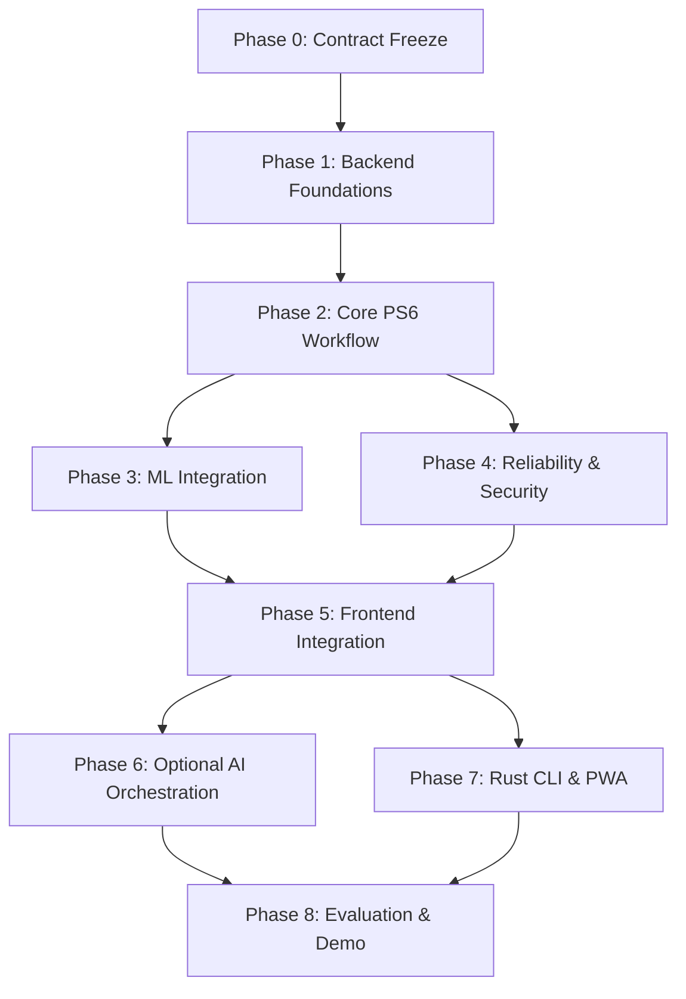

# 00 · Canonical Phase-Wise Implementation Plan

## 1. Target Outcome

Deliver one coherent, fully auditable, and end-to-end verified implementation of SUTRA:
**Simulated Observations → Deterministic Signal & Evidence Card → Human Review → Assigned Case → Enforceable Due Date & Escalation → Verified Follow-up → Documented Outcome → Cohort Operational Analytics.**

Guided by the non-negotiable principle: **“No Alert Without Action.”**

---

## 2. Canonical Phase Roadmap

| Phase | Phase Name | Primary Deliverables | Strict Exit Gate |
|---|---|---|---|
| **Phase 0** | **Repository Audit & Contract Freeze** | Reconciled documentation, canonical OpenAPI 3.1 contract, verified ML status inventory, architecture decision records. | Zero contradictory documentation; ML artifact vs research status explicitly differentiated; canonical API paths locked. |
| **Phase 1** | **Backend Foundations** | FastAPI application structure, Pydantic v2 schemas, SQLAlchemy 2.x models, Alembic migrations, Supabase JWT verification, campus authorization middleware, `/health` and `/ready` endpoints. | Server-side JWT verification enforced; unauthenticated or cross-campus requests denied; database migrations apply cleanly. |
| **Phase 2** | **Core PS6 Workflow** | Observation ingestion (6 domains), temporal filtering (`available_at <= T`), deterministic policy engine, evidence packet generator, human signal review, case creation, task assignments, follow-ups, outcomes, audit logging. | Complete student support journey executable via REST API; invalid state transitions rejected; sensitive finance/counselling records segregated. |
| **Phase 3** | **ML Integration & Serving** | Isolated `app.ml` internal module invoking `sutra_ml`, Pydantic inference contracts, Day-30 feature extraction, baseline Logistic Regression v1.0.0 (threshold 0.46) loader, research XGBoost containment, Evidence Card generator, compatibility route aliases. | Inference passes all 26 leakage/data-quality tests; missing data handled as `unknown` (never zero); ML predictions produce Evidence Cards and never auto-trigger interventions. |
| **Phase 4** | **Reliability & Security** | Request idempotency middleware (`Idempotency-Key`), PostgreSQL transactional outbox pattern, durable deadline worker, retry backoff, tenant isolation test suite, comprehensive negative authorization matrix. | Idempotent retries produce zero duplicate mutations; worker restart recovers due tasks safely; negative authorization suite passes 100%. |
| **Phase 5** | **Frontend Integration** | Next.js App Router client, React components, Tailwind styling, typed API client integration, authentication state management, educator workflows (Signal Queue, Case Detail, Follow-up Modal, Cohort Dashboard). | End-to-end user workflow functional from browser; UI strictly respects role boundaries; zero sensitive data leaked in client state. |
| **Phase 6** | **Optional AI Orchestration** | Bounded LLM assistance endpoints (`/api/v1/ai/summarize-evidence`, `/api/v1/ai/suggest-intervention`, `/api/v1/ai/draft-followup`), context minimization filters, strict Pydantic output parsing, execution audit logging. | AI operates strictly read-only; zero direct DB mutations; human approval mandatory; system degrades gracefully on provider failure. |
| **Phase 7** | **Rust CLI & PWA Enhancements** | Standalone Rust CLI communicating exclusively via authenticated HTTPS `/api/v1` routes; PWA offline manifest and service worker (strictly omitting sensitive data caching). | CLI respects identical server-side authorization and produces identical audit logs; zero direct database connections. |
| **Phase 8** | **Evaluation & Demonstration** | End-to-end automated acceptance tests, synthetic seed replay script, developer runbook, limitations disclosure, live presentation rehearsal. | Fresh developer can deploy, migrate, seed, and execute complete demo journey without manual database or metrics tampering. |

---

## 3. Strict Dependency Order

### Dependency Rules:
1. **Foundations Before Features:** Phase 1 (Auth, DB models, Alembic) is an absolute blocker for Phase 2. No business route can be created without campus-level authorization.
2. **Deterministic Core Before ML Serving:** Phase 2 (Deterministic signals, human review, cases) must be functional before Phase 3 (ML inference) is wired in. ML provides decision-support evidence to the existing review engine; it does not replace the review engine.
3. **Core Workflow Before Frontend & Tooling:** Phase 5 (Next.js) depends directly on verified APIs from Phases 2, 3, and 4.
4. **Optional Features Deferred:** AI Orchestration (Phase 6), Rust CLI (Phase 7), and PWA enhancements must never block the core PS6 demonstration path.

---

## 4. Definition of Done for Every Phase

Every implementation phase must satisfy all of the following criteria before declaration of completion:
- **Test Automation:** Automated Pytest unit, integration, and security negative tests pass reliably in CI.
- **Contract Adherence:** All input payloads and responses strictly adhere to the canonical OpenAPI 3.1.0 specification.
- **Authorization Enforcement:** Protected operations enforce campus boundary and active role permissions server-side.
- **Data Minimization:** Response DTOs contain only purpose-minimized fields; sensitive finance/counselling payloads are segregated.
- **Audit Logging:** Consequential state changes generate timestamped audit records with actor reference, reason code, and idempotency key.
- **Documentation Parity:** Architecture docs, backlog checklists, and OpenAPI schemas are synchronized with actual code changes.

---

## 5. Scope Fence & Triage Guidelines

- **Must Build (Core PS6 Path):** All 6 observation domains, deterministic policy rules, explainable evidence packets, human review workflow, role-aware assignment, deadlines and escalation, follow-up proof, attributed outcomes, cohort analytics, and non-punitive safeguards.
- **Restricted/Gated Options:** Financial support tasks and counselling referrals require explicit domain capabilities. Adult-student parent contact is strictly non-automated and gated.
- **Explicitly Deferred:** External live SIS/LMS integrations (e.g. EduEagle) without official sandboxes, live autonomous dropout classification, autonomous agentic frameworks, multi-tenant cloud infrastructure guarantees.

### If Schedule Slips:
Preserve: **Campus Authorization → Core Case Lifecycle → Temporal Anti-Leakage → Human Review Audit → Dashboard Correctness**.  
Cut First: Optional AI summarization, Rust CLI, PWA service worker, external webhook notifications, and advanced UI animations.
