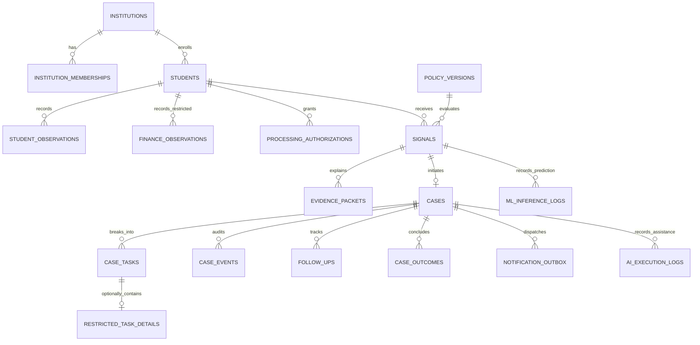

# 03 · Data Model, SQLAlchemy 2.x Schemas & Migrations

## 1. Modeling Principles

- **Tenant / Campus Isolation:** Every institution-owned table includes `institution_id` (representing the campus boundary). Multi-campus queries are partitioned at the database level.
- **Separation of Concerns:** Raw observations, deterministic rules, derived signals, reviewed cases, subtasks, follow-up proof, and final outcomes reside in decoupled, normalized tables.
- **Sensitive Domain Segregation:** Sensitive financial observations (`finance_observations`) and confidential task details (`restricted_task_details`) are physically separated into dedicated tables. They are never joined into broad default views.
- **Strict Temporal Distinction:** `event_at` (when occurrence happened), `available_at` (when data became visible to decision makers), `ingested_at` (when system wrote record), and `decision_at` (when rule/model ran) are distinct, immutable timestamps.
- **Retention & Provenance:** Decisions link directly to immutable `policy_versions` and frozen `evidence_packets`.

---

## 2. Entity Relationships (ERD)

---

## 3. Core Database Tables & Data Dictionary

| Table Name | SQLAlchemy Model | Purpose & Description | Key Constraints & Invariants |
|---|---|---|---|
| `institutions` | `Institution` | Campus / tenant entity. | `id` UUID PK, `status` ('active', 'disabled'). |
| `institution_memberships` | `InstitutionMembership` | User role mapping within campus. | Unique `(institution_id, user_id, role)`. Active flag. |
| `students` | `Student` | Pseudonymous student identity and cohort. | Unique `(institution_id, external_ref)`. `enrollment_status`. |
| `processing_authorizations` | `ProcessingAuthorization` | Purpose-bound consent/policy basis. | Unique `(student_id, purpose_key)`. Status, validity dates. |
| `source_imports` | `SourceImport` | Batch upload record for CSV/JSON. | Unique `(institution_id, digest)`. Accepted/error row counts. |
| `student_observations` | `StudentObservation` | General observations (5 categories). | Unique `(institution_id, student_id, domain, metric_key, event_at)`. |
| `finance_observations` | `FinanceObservation` | Restricted fee-support observations. | Isolated table. Role `finance` required. |
| `policy_versions` | `PolicyVersion` | Immutable deterministic rule sets. | Unique `(policy_key, version)`. Checksum digest. |
| `evidence_packets` | `EvidencePacket` | Frozen snapshot of observations at cutoff. | `as_of_at` timestamp, JSONB snapshot, SHA256 digest. |
| `signals` | `Signal` | Evaluated risk alert and evidence link. | Unique `(student_id, policy_version_id, as_of_at)`. Quality state. |
| `intervention_catalog` | `InterventionCatalog` | Controlled menu of support actions. | `intervention_key` PK, domain, target roles, approval flag. |
| `cases` | `Case` | Coordination unit for student support. | Unique `(signal_id)`. Optimistic locking `version`. State enum. |
| `case_tasks` | `CaseTask` | Deliverable domain subtask. | Generic labels, due dates, assignee, completion status. |
| `restricted_task_details` | `RestrictedTaskDetail` | Sensitive finance/counselling payload. | FK to `case_tasks`. Strict purpose & capability check. |
| `case_events` | `CaseEvent` | Append-only audit history of transitions. | Actor ID, event type, before/after states, reason code. |
| `follow_ups` | `FollowUp` | Evidence of contact and support delivery. | `contact_status`, `proof_kind`, occurred timestamp, note. |
| `case_outcomes` | `CaseOutcome` | Attributed post-support result. | `outcome_status` ('helped', 'not_helped', 'mixed', 'unknown'). |
| `notification_outbox` | `NotificationOutbox` | Transactional outbox for worker dispatch. | Status, retry count, next attempt time, idempotency key. |
| `ml_inference_logs` | `MLInferenceLog` | Serving audit for ML model predictions. | Model name, version (v1.0.0), probability, threshold (0.46), SHAP attributions. |
| `ai_execution_logs` | `AIExecutionLog` | Execution audit for optional LLM runs. | Feature key, prompt token count, latency, human approval status. |

---

## 4. Controlled Enumerations & Values

- **Campus Roles:** `faculty`, `hod`, `mentor`, `counsellor`, `placement`, `finance`, `leadership`, `institution_admin`.
- **Observation Domains (General):** `attendance`, `academic`, `participation`, `skills`, `faculty_feedback`.
- **Restricted Domains:** `finance`, `counselling`, `parent_contact_review`.
- **Signal Results:** `attention_suggested`, `no_rule_triggered`, `unknown`.
- **Quality States:** `sufficient`, `insufficient_evidence`, `stale_source`, `conflicting_source`, `missing_denominator`.
- **Review Decisions:** `approve`, `modify`, `dismiss`, `request_more_data`.
- **Case Lifecycle States:** `suggested`, `under_review`, `action_planned`, `assigned`, `accepted`, `contact_attempted`, `support_in_progress`, `follow_up_due`, `outcome_reviewed`, `closed`, `dismissed`, `student_declined`, `service_unavailable`, `failed_contact`, `referred`, `reopened`.
- **Proof Kinds:** `staff_attestation`, `student_confirmation`, `system_event`, `document_reference`.
- **Outcome Statuses:** `helped`, `not_helped`, `mixed`, `unknown`.

---

## 5. Indexes, Integrity Constraints & Alembic Migration Strategy

### Indexes for High-Frequency Query Paths:
1. `idx_memberships_user_active`: `(user_id, is_active, institution_id)`
2. `idx_students_cohort`: `(institution_id, cohort_code, enrollment_status)`
3. `idx_observations_lookup`: `(institution_id, student_id, domain, available_at)`
4. `idx_signals_queue`: `(institution_id, result, created_at)`
5. `idx_cases_due_queue`: `(institution_id, current_state, due_at)`
6. `idx_outbox_pending`: `(status, next_attempt_at) WHERE status IN ('pending', 'failed')`

### Alembic Migration Sequence:
- `001_initial_core_schema.py`: Tables, foreign keys, check constraints, and performance indexes.
- `002_rls_policies_and_grants.py`: Explicit PostgreSQL Row Level Security policies and role-based grants.
- `003_ml_and_ai_audit_tables.py`: `ml_inference_logs` and `ai_execution_logs` tables.
- All migrations must support deterministic rollback (`downgrade()`) and include unit tests validating schema upgrades.
