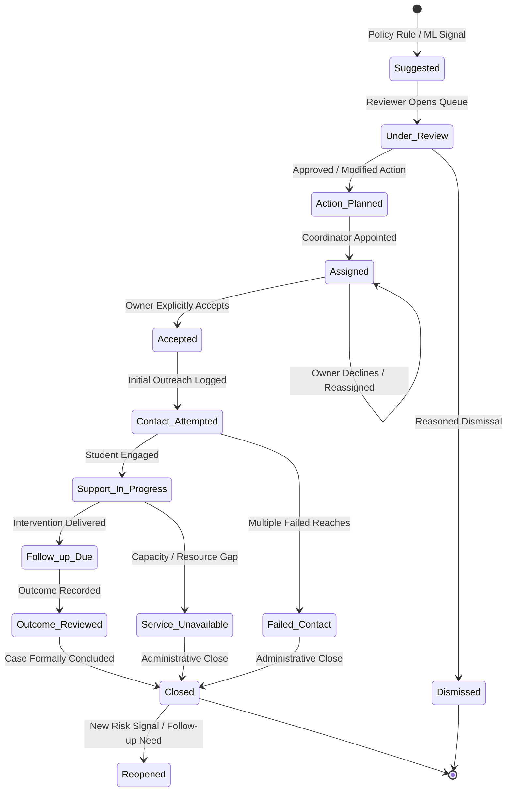
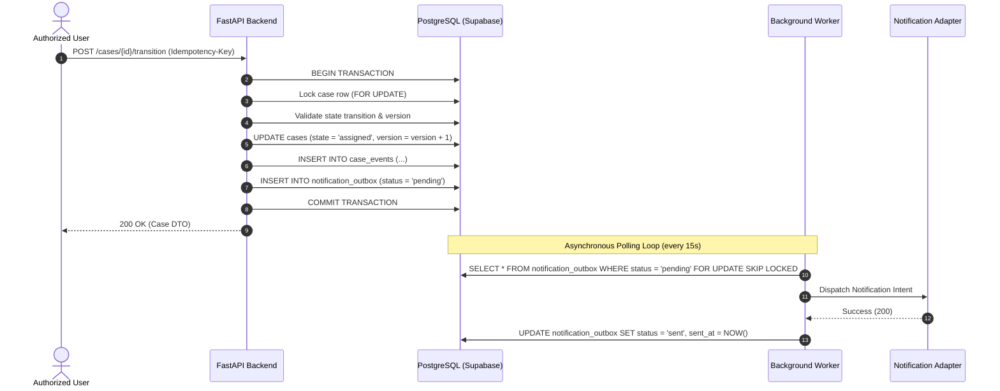

# 07 · Case Lifecycle, State Machine & Durable Outbox Worker

## 1. Primary Case Lifecycle & State Machine

The core product principle **“No Alert Without Action”** is operationalized through a strict 10-stage primary lifecycle:

---

## 2. Formal Transition Rules & Validations

| From State | Allowed To State | Required Roles | Required Payload Fields | Event Emitted |
|---|---|---|---|---|
| `suggested` | `under_review` | Faculty, HOD, Mentor | `signal_id` | `CASE_REVIEW_STARTED` |
| `under_review` | `action_planned` | Faculty, HOD, Mentor | `selected_intervention_key`, `reason_code` | `INTERVENTION_APPROVED` |
| `under_review` | `dismissed` | Faculty, HOD, Mentor | `dismissal_reason_code`, `rationale` | `SIGNAL_DISMISSED` |
| `action_planned` | `assigned` | HOD, Mentor, Admin | `primary_owner_user_id`, `due_at` | `OWNER_ASSIGNED` |
| `assigned` | `accepted` | Assigned User Only | `acceptance_note` (optional) | `ASSIGNMENT_ACCEPTED` |
| `assigned` | `assigned` (reassign) | HOD, Mentor, Admin | `new_owner_user_id`, `reassignment_reason` | `OWNER_REASSIGNED` |
| `accepted` | `contact_attempted` | Assigned User | `occurred_at`, `proof_kind` | `CONTACT_ATTEMPTED` |
| `contact_attempted` | `support_in_progress`| Assigned User | `contact_status: "student_reached"` | `SUPPORT_STARTED` |
| `contact_attempted` | `failed_contact` | Assigned User | `reason_code`, `attempts_count` | `CONTACT_FAILED` |
| `support_in_progress`| `follow_up_due` | Assigned User | `delivery_proof_ref`, `follow_up_due_at` | `SUPPORT_DELIVERED` |
| `follow_up_due` | `outcome_reviewed` | Assigned User, HOD | `outcome_status`, `rationale` | `OUTCOME_RECORDED` |
| `outcome_reviewed` | `closed` | Assigned User, HOD | `closing_note` | `CASE_CLOSED` |
| `closed` | `reopened` | HOD, Admin | `reopen_reason_code`, `next_action` | `CASE_REOPENED` |

> [!IMPORTANT]
> **No Generic Arbitrary Updates:** There is no generic `PATCH /cases/{id}` endpoint allowing arbitrary state updates. All state mutations must use explicit, transition-specific routes (e.g. `POST /cases/{id}/transition`, `POST /cases/{id}/assignment`, `POST /cases/{id}/accept-assignment`).

---

## 3. Accountable Ownership & Domain Subtasks

- **Single Primary Coordinator:** Every active case has exactly one primary accountable owner (`primary_owner_user_id`) responsible for meeting deadlines.
- **Separation of Assignment and Acceptance:** Assigning an owner does not mean work has started. The owner must explicitly call `/cases/{id}/accept-assignment` to acknowledge responsibility.
- **Domain Subtasks:** Specialized support actions (financial aid, mental health counselling) are spawned as `CaseTask` rows assigned to domain specialists (`finance`, `counsellor`). Sensitive subtask notes are kept in `restricted_task_details`.

---

## 4. PostgreSQL Transactional Outbox Pattern & Background Worker

SUTRA guarantees durable asynchronous execution without external message brokers using the transactional outbox pattern:

### Deadline & Escalation Worker Loop:
1. Scans `cases` where `current_state NOT IN ('closed', 'dismissed') AND due_at < NOW() AND is_escalated = false`.
2. Marks case as `is_escalated = true`.
3. Inserts a `CASE_ESCALATED` event into `case_events`.
4. Inserts a supervisor notification intent into `notification_outbox`.
5. Bounded backoff retry strategy for failed outbox dispatches (max 5 attempts before marking `dead_letter`).

---

## 5. Request Idempotency & Optimistic Concurrency

- **Idempotency-Key Header:** Required on all mutation endpoints. A duplicate request with an identical key within 24 hours returns the cached response without creating duplicate database writes or outbox messages.
- **Optimistic Concurrency Control:** Every case row carries an integer `version`. Mutations supply `version`; if a concurrent update modified the row, a `409 Conflict` (`CONCURRENT_CASE_MODIFICATION`) is raised.

---

## 6. Controlled Demo Clock (Evaluation Runbook)

For testing and demonstration, SUTRA supports a virtual simulation clock (`SUTRA_DEMO_MODE=true`):
- Time provider injects `effective_now` rather than system wall time.
- Allows demonstration of deadline expiration and escalation in seconds without modifying historical event timestamps.
- Disabled in production environments (`ENVIRONMENT=production`).
