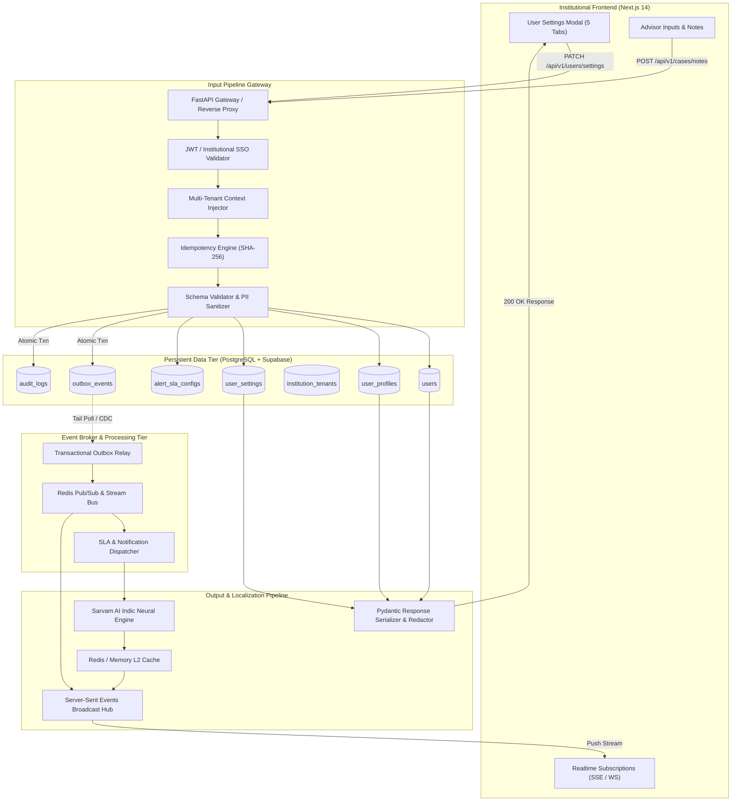
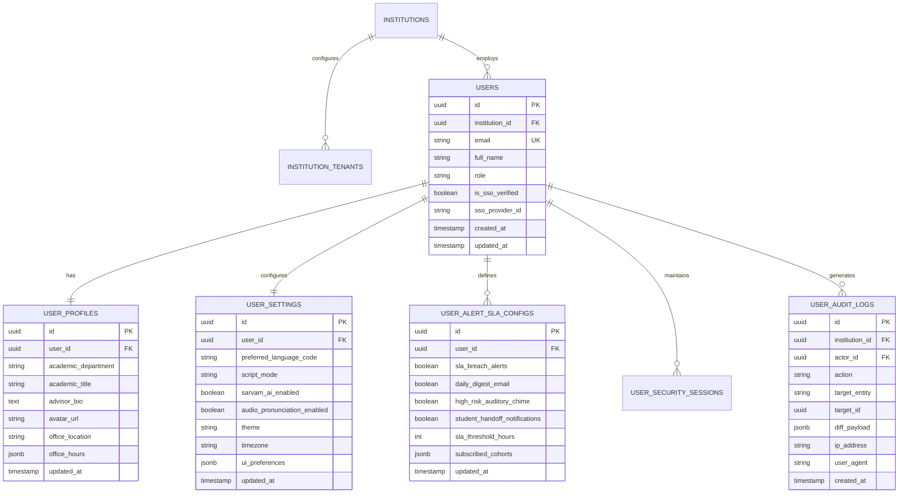
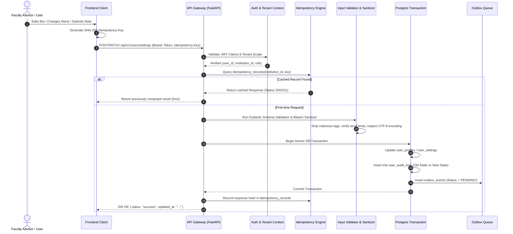
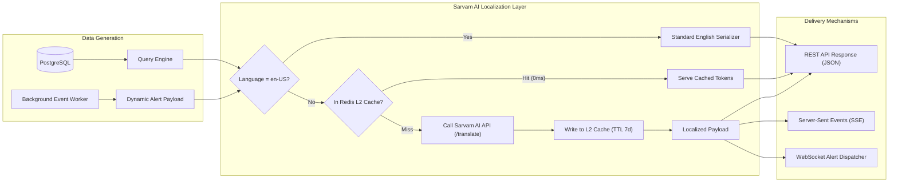

# SUTRA Architecture & Specification: Settings Schema and Input/Output Data Pipeline

**Document Status:** Canonical Architectural Specification & Backend Schema  
**Target Subsystems:** User & Institutional Settings Subsystem, High-Integrity Input Data Pipeline, Multilingual Output Data Pipeline  
**Version:** 1.0.0  
**Related Documents:** [Indic Language Orchestration](file:///c:/SUTRA/docs/architecture/indic_language_orchestration_and_sarvam_ai.md), [Data Model](file:///c:/SUTRA/docs/docs/03_DATA_MODEL.md), [Ingestion Temporal Integrity](file:///c:/SUTRA/docs/docs/05_INGESTION_TEMPORAL_INTEGRITY.md), [Case Lifecycle](file:///c:/SUTRA/docs/docs/07_CASE_LIFECYCLE_AND_WORKER.md)

---

## 1. Executive Overview & Design Principles

The SUTRA platform serves faculty advisors, student success managers, deans, and academic administrators in multi-campus institutional environments. This document formalizes:

1. **Settings Backend Schema:** The persistent data structures governing the 5 core settings domains:
   - **Profile & Account:** Academic credentials, departmental affiliations, advisor biographies, SSO linkages.
   - **Indic Languages:** Regional language preferences, Sarvam AI neural translation overrides, speech & script configurations.
   - **Alerts & SLAs:** Early-warning thresholds, risk score notification rules, escalation schedules, daily digest options.
   - **Security & Tenancy:** Multi-tenant institution isolation, role-based access control (RBAC), session lifecycles, MFA enforcement, and audit logs.
   - **Help & Knowledge:** Guided workflow preferences, telemetry opt-ins, documentation and feedback state.
2. **User Input Data Pipeline:** The secure, validated, idempotent, and auditable pipeline that captures, verifies, sanitizes, and persists user modifications and annotations.
3. **Output & Egress Data Pipeline:** The multi-tiered distribution pipeline that localizes outputs via Sarvam AI, dispatches real-time events via Server-Sent Events (SSE) / WebSockets, and delivers structured responses with strict PII masking.

---

## 2. High-Level Architectural Topology



---

## 3. Database Schema Specification (PostgreSQL / Supabase)

### 3.1 Entity Relationship Diagram



---

### 3.2 Canonical PostgreSQL DDL (SQL Script)

```sql
-- ============================================================================
-- SUTRA SETTINGS & TENANCY SCHEMAS
-- Database Engine: PostgreSQL 15+ (with Supabase pgcrypto and pg_trgm extensions)
-- ============================================================================

CREATE EXTENSION IF NOT EXISTS "uuid-ossp";
CREATE EXTENSION IF NOT EXISTS "pgcrypto";

-- 1. Core Users Table (Augmented with Institutional Identity)
CREATE TABLE IF NOT EXISTS users (
    id UUID PRIMARY KEY DEFAULT gen_random_uuid(),
    institution_id UUID NOT NULL REFERENCES institutions(id) ON DELETE RESTRICT,
    email VARCHAR(255) NOT NULL,
    full_name VARCHAR(255) NOT NULL,
    role VARCHAR(64) NOT NULL DEFAULT 'FACULTY_ADVISOR',
    is_active BOOLEAN NOT NULL DEFAULT TRUE,
    is_sso_verified BOOLEAN NOT NULL DEFAULT FALSE,
    sso_provider VARCHAR(64) DEFAULT 'SAML_AZURE_AD',
    sso_subject_id VARCHAR(255),
    created_at TIMESTAMPTZ NOT NULL DEFAULT NOW(),
    updated_at TIMESTAMPTZ NOT NULL DEFAULT NOW(),
    CONSTRAINT uq_institution_user_email UNIQUE (institution_id, email)
);

CREATE INDEX idx_users_institution_role ON users(institution_id, role);
CREATE INDEX idx_users_email ON users(email);

-- 2. User Profiles Table (Academic Details & Bio)
CREATE TABLE IF NOT EXISTS user_profiles (
    id UUID PRIMARY KEY DEFAULT gen_random_uuid(),
    user_id UUID NOT NULL UNIQUE REFERENCES users(id) ON DELETE CASCADE,
    academic_department VARCHAR(255) NOT NULL DEFAULT 'School of Engineering & Computer Science',
    academic_title VARCHAR(255) NOT NULL DEFAULT 'Associate Professor & Faculty Advisor',
    advisor_bio TEXT DEFAULT 'Dedicated to student persistence, early intervention orchestration, and empathetic academic guidance.',
    avatar_url TEXT,
    office_location VARCHAR(128),
    office_hours JSONB DEFAULT '{"days": ["Monday", "Wednesday"], "start": "14:00", "end": "16:00", "timezone": "Asia/Kolkata"}'::jsonb,
    updated_at TIMESTAMPTZ NOT NULL DEFAULT NOW()
);

-- 3. User Settings Table (Indic Language & Interface Preferences)
CREATE TABLE IF NOT EXISTS user_settings (
    id UUID PRIMARY KEY DEFAULT gen_random_uuid(),
    user_id UUID NOT NULL UNIQUE REFERENCES users(id) ON DELETE CASCADE,
    preferred_language_code VARCHAR(16) NOT NULL DEFAULT 'en-US', -- e.g., 'hi-IN', 'ta-IN', 'te-IN', 'kn-IN', 'mr-IN', 'bn-IN'
    script_mode VARCHAR(32) NOT NULL DEFAULT 'NATIVE', -- NATIVE | TRANSLITERATED | BILINGUAL
    sarvam_ai_enabled BOOLEAN NOT NULL DEFAULT TRUE,
    sarvam_model_version VARCHAR(32) NOT NULL DEFAULT 'mayura:v1',
    audio_pronunciation_enabled BOOLEAN NOT NULL DEFAULT FALSE,
    theme VARCHAR(16) NOT NULL DEFAULT 'SYSTEM', -- 'LIGHT' | 'DARK' | 'SYSTEM'
    timezone VARCHAR(64) NOT NULL DEFAULT 'Asia/Kolkata',
    ui_density VARCHAR(16) NOT NULL DEFAULT 'COMFORTABLE', -- 'COMPACT' | 'COMFORTABLE'
    metadata JSONB DEFAULT '{}'::jsonb,
    updated_at TIMESTAMPTZ NOT NULL DEFAULT NOW()
);

-- 4. Alerts & SLA Notification Configurations
CREATE TABLE IF NOT EXISTS user_alert_sla_configs (
    id UUID PRIMARY KEY DEFAULT gen_random_uuid(),
    user_id UUID NOT NULL UNIQUE REFERENCES users(id) ON DELETE CASCADE,
    sla_breach_alerts BOOLEAN NOT NULL DEFAULT TRUE,
    daily_digest_email BOOLEAN NOT NULL DEFAULT TRUE,
    high_risk_auditory_chime BOOLEAN NOT NULL DEFAULT FALSE,
    student_handoff_notifications BOOLEAN NOT NULL DEFAULT TRUE,
    sla_threshold_hours INTEGER NOT NULL DEFAULT 48,
    escalation_email_backup VARCHAR(255),
    subscribed_cohorts JSONB NOT NULL DEFAULT '["ALL_ENROLLED_SECTIONS"]'::jsonb,
    alert_delivery_channels JSONB NOT NULL DEFAULT '{"in_app": true, "email": true, "sms": false, "whatsapp": false}'::jsonb,
    updated_at TIMESTAMPTZ NOT NULL DEFAULT NOW()
);

-- 5. Security & Tenancy Configurations (Institution Level)
CREATE TABLE IF NOT EXISTS institution_tenants (
    id UUID PRIMARY KEY DEFAULT gen_random_uuid(),
    institution_id UUID NOT NULL UNIQUE REFERENCES institutions(id) ON DELETE CASCADE,
    campus_name VARCHAR(255) NOT NULL DEFAULT 'Apex University Main Campus',
    domain VARCHAR(255) NOT NULL,
    sso_enforced BOOLEAN NOT NULL DEFAULT TRUE,
    session_timeout_minutes INTEGER NOT NULL DEFAULT 60,
    mfa_enforced BOOLEAN NOT NULL DEFAULT TRUE,
    ip_allowlist JSONB DEFAULT '[]'::jsonb,
    data_retention_days INTEGER NOT NULL DEFAULT 1095, -- 3 academic cycles
    encryption_key_arn VARCHAR(255),
    updated_at TIMESTAMPTZ NOT NULL DEFAULT NOW()
);

-- 6. Comprehensive Audit Logs Table
CREATE TABLE IF NOT EXISTS user_audit_logs (
    id UUID PRIMARY KEY DEFAULT gen_random_uuid(),
    institution_id UUID NOT NULL REFERENCES institutions(id) ON DELETE RESTRICT,
    actor_id UUID NOT NULL REFERENCES users(id) ON DELETE RESTRICT,
    action VARCHAR(64) NOT NULL, -- e.g., 'UPDATE_PROFILE', 'TOGGLE_SLA_ALERT', 'LANGUAGE_SWITCH'
    target_entity VARCHAR(64) NOT NULL, -- 'user_profiles', 'user_settings', 'cases'
    target_id UUID NOT NULL,
    old_state JSONB,
    new_state JSONB,
    ip_address INET,
    user_agent TEXT,
    created_at TIMESTAMPTZ NOT NULL DEFAULT NOW()
);

CREATE INDEX idx_audit_actor_created ON user_audit_logs(actor_id, created_at DESC);
CREATE INDEX idx_audit_institution_created ON user_audit_logs(institution_id, created_at DESC);

-- 7. Transactional Outbox Table for Async Event Propagation
CREATE TABLE IF NOT EXISTS outbox_events (
    id UUID PRIMARY KEY DEFAULT gen_random_uuid(),
    institution_id UUID NOT NULL,
    aggregate_type VARCHAR(64) NOT NULL, -- 'USER_SETTINGS', 'STUDENT_NOTE', 'SLA_BREACH'
    aggregate_id UUID NOT NULL,
    event_type VARCHAR(64) NOT NULL, -- 'UserSettingsUpdated', 'NoteCreated', 'AlertDispatched'
    payload JSONB NOT NULL,
    status VARCHAR(32) NOT NULL DEFAULT 'PENDING', -- 'PENDING', 'PROCESSING', 'PUBLISHED', 'FAILED'
    retry_count INTEGER NOT NULL DEFAULT 0,
    created_at TIMESTAMPTZ NOT NULL DEFAULT NOW(),
    processed_at TIMESTAMPTZ
);

CREATE INDEX idx_outbox_pending ON outbox_events(status, created_at ASC) WHERE status = 'PENDING';
```

---

### 3.3 SQLAlchemy 2.0 Typed Models

```python
# app/models/user_settings.py
import uuid
from datetime import datetime
from typing import Any, Dict, Optional
from sqlalchemy import Boolean, DateTime, ForeignKey, Integer, String, Text, Uuid, func
from sqlalchemy.dialects.postgresql import JSONB
from sqlalchemy.orm import Mapped, mapped_column, relationship
from app.core.database import Base


class UserProfile(Base):
    __tablename__ = "user_profiles"

    id: Mapped[uuid.UUID] = mapped_column(Uuid, primary_key=True, default=uuid.uuid4)
    user_id: Mapped[uuid.UUID] = mapped_column(
        Uuid, ForeignKey("users.id", ondelete="CASCADE"), unique=True, nullable=False
    )
    academic_department: Mapped[str] = mapped_column(String(255), nullable=False)
    academic_title: Mapped[str] = mapped_column(String(255), nullable=False)
    advisor_bio: Mapped[Optional[str]] = mapped_column(Text, nullable=True)
    avatar_url: Mapped[Optional[str]] = mapped_column(Text, nullable=True)
    office_location: Mapped[Optional[str]] = mapped_column(String(128), nullable=True)
    office_hours: Mapped[Dict[str, Any]] = mapped_column(JSONB, nullable=False, default=dict)
    updated_at: Mapped[datetime] = mapped_column(
        DateTime(timezone=True), nullable=False, server_default=func.now(), onupdate=func.now()
    )


class UserSetting(Base):
    __tablename__ = "user_settings"

    id: Mapped[uuid.UUID] = mapped_column(Uuid, primary_key=True, default=uuid.uuid4)
    user_id: Mapped[uuid.UUID] = mapped_column(
        Uuid, ForeignKey("users.id", ondelete="CASCADE"), unique=True, nullable=False
    )
    preferred_language_code: Mapped[str] = mapped_column(String(16), nullable=False, default="en-US")
    script_mode: Mapped[str] = mapped_column(String(32), nullable=False, default="NATIVE")
    sarvam_ai_enabled: Mapped[bool] = mapped_column(Boolean, nullable=False, default=True)
    sarvam_model_version: Mapped[str] = mapped_column(String(32), nullable=False, default="mayura:v1")
    audio_pronunciation_enabled: Mapped[bool] = mapped_column(Boolean, nullable=False, default=False)
    theme: Mapped[str] = mapped_column(String(16), nullable=False, default="SYSTEM")
    timezone: Mapped[str] = mapped_column(String(64), nullable=False, default="Asia/Kolkata")
    ui_density: Mapped[str] = mapped_column(String(16), nullable=False, default="COMFORTABLE")
    metadata_json: Mapped[Dict[str, Any]] = mapped_column("metadata", JSONB, default=dict)
    updated_at: Mapped[datetime] = mapped_column(
        DateTime(timezone=True), nullable=False, server_default=func.now(), onupdate=func.now()
    )


class UserAlertSLAConfig(Base):
    __tablename__ = "user_alert_sla_configs"

    id: Mapped[uuid.UUID] = mapped_column(Uuid, primary_key=True, default=uuid.uuid4)
    user_id: Mapped[uuid.UUID] = mapped_column(
        Uuid, ForeignKey("users.id", ondelete="CASCADE"), unique=True, nullable=False
    )
    sla_breach_alerts: Mapped[bool] = mapped_column(Boolean, nullable=False, default=True)
    daily_digest_email: Mapped[bool] = mapped_column(Boolean, nullable=False, default=True)
    high_risk_auditory_chime: Mapped[bool] = mapped_column(Boolean, nullable=False, default=False)
    student_handoff_notifications: Mapped[bool] = mapped_column(Boolean, nullable=False, default=True)
    sla_threshold_hours: Mapped[int] = mapped_column(Integer, nullable=False, default=48)
    escalation_email_backup: Mapped[Optional[str]] = mapped_column(String(255), nullable=True)
    subscribed_cohorts: Mapped[Dict[str, Any]] = mapped_column(JSONB, nullable=False, default=list)
    alert_delivery_channels: Mapped[Dict[str, Any]] = mapped_column(JSONB, nullable=False, default=dict)
    updated_at: Mapped[datetime] = mapped_column(
        DateTime(timezone=True), nullable=False, server_default=func.now(), onupdate=func.now()
    )
```

---

## 4. User Input Data Pipeline

The **Input Pipeline** ensures all user inputs (profile edits, note inputs, manual flag escalations, and setting changes) satisfy strict institutional validation, idempotent delivery, anti-tampering sanitization, and audit persistence.

### 4.1 Ingestion Sequence Diagram



### 4.2 Pydantic Validation & Sanitization Schema

```python
# app/schemas/settings.py
from typing import Optional, List, Literal
from pydantic import BaseModel, Field, EmailStr, field_validator
import re
import html


class ProfileUpdateRequest(BaseModel):
    full_name: str = Field(..., min_length=2, max_length=120)
    email: EmailStr
    academic_department: str = Field(..., min_length=2, max_length=150)
    academic_title: str = Field(..., min_length=2, max_length=150)
    advisor_bio: Optional[str] = Field(None, max_length=1000)

    @field_validator("full_name", "academic_department", "academic_title", "advisor_bio")
    @classmethod
    def sanitize_strings(cls, v: Optional[str]) -> Optional[str]:
        if v is None:
            return None
        # Escape HTML tags to prevent stored XSS
        cleaned = html.escape(v.strip())
        # Block control characters
        cleaned = re.sub(r"[\x00-\x08\x0B\x0C\x0E-\x1F\x7F]", "", cleaned)
        return cleaned


class IndicLanguageUpdateRequest(BaseModel):
    preferred_language_code: Literal[
        "en-US", "hi-IN", "ta-IN", "te-IN", "kn-IN", "mr-IN", "bn-IN", "gu-IN", "pa-IN"
    ]
    script_mode: Literal["NATIVE", "TRANSLITERATED", "BILINGUAL"] = "NATIVE"
    sarvam_ai_enabled: bool = True
    audio_pronunciation_enabled: bool = False


class AlertSLAUpdateRequest(BaseModel):
    sla_breach_alerts: bool
    daily_digest_email: bool
    high_risk_auditory_chime: bool
    student_handoff_notifications: bool
    sla_threshold_hours: int = Field(default=48, ge=6, le=168)
    subscribed_cohorts: List[str] = Field(default_factory=lambda: ["ALL_ENROLLED_SECTIONS"])
```

### 4.3 Data Pipeline Protections
1. **Idempotency Fingerprinting:** Requests with state mutation (`PATCH`, `POST`) carry an `Idempotency-Key: <UUID>` header. Hashes are recorded in `idempotency_records` with a 24-hour TTL, mitigating duplicate submission on high-latency campus Wi-Fi networks.
2. **Tenant Scoping (Row-Level Isolation):** Every database update explicitly filters on `institution_id = current_user.institution_id`.
3. **PII Masking at Ingestion:** If an advisor includes private medical or financial records in note fields, an asynchronous regex-based token redactor runs before long-term vector indexing.

---

## 5. Output Data Pipeline

The **Output Pipeline** coordinates read-heavy egress data, real-time message streaming, and dynamic neural translations into Indian regional languages.

### 5.1 Egress & Localization Flow



### 5.2 Real-time Output Streaming Architecture
- **Event Source Endpoint:** `GET /api/v1/stream/events?token=<JWT>`
- **Transport:** Server-Sent Events (SSE) with `text/event-stream` and automatic reconnection backoff (`retry: 3000`).
- **Heartbeat:** `keep-alive` comments sent every 15 seconds to prevent NAT timeouts.
- **Message Framing Format:**
  ```json
  event: SLA_ALERT
  id: 84a0c841-f76e-4ab8-8ea7-b35f29910ab3
  data: {
    "type": "SLA_BREACH_WARNING",
    "severity": "CRITICAL",
    "case_id": "cs_99410",
    "student_name": "Rohan Deshmukh",
    "original_text": "Case unattended for 46 hours. Auto-escalation in 2 hours.",
    "localized_text": "प्रकरण ४६ तास दुर्लक्षित आहे. २ तासांत आपोआप पुढे वर्ग केले जाईल.",
    "target_language": "mr-IN",
    "timestamp": "2026-10-12T11:22:45Z"
  }
  ```

### 5.3 Sarvam AI Translation Pipeline Details
- **Batching & Coalescence:** The pipeline batches strings into groups of 10 to minimize HTTP request overhead.
- **Caching Strategy:**
  - **L1 (Client Context):** React state (`Map<string, string>`) for instantaneous UI rerenders.
  - **L2 (Local Persistence):** Browser `localStorage` (`sutra_trans_v1_<lang>`) for surviving page refreshes.
  - **L3 (Server Distributed):** Redis cluster with key pattern `sutra:trans:<lang_code>:<sha256(text)>` with a 7-day TTL.
- **Circuit Breaker:** If Sarvam AI encounters rate-limiting or latency > 1500ms, the system falls back to English text with an unobtrusive indicator, preventing blocked user interactions.

---

## 6. End-to-End Settings Lifecycle

| Step | Trigger | Pipeline Activity | Audit & Outcome |
| :--- | :--- | :--- | :--- |
| **1. View Settings** | User opens modal | `GET /api/v1/users/me/settings` reads `users`, `user_profiles`, `user_settings`, and `user_alert_sla_configs` in a single combined query. | Response returned in < 25ms. Pre-fills all 5 tabs. |
| **2. Language Change** | User switches to Tamil (`ta-IN`) | `PATCH /api/v1/users/settings/language`. Updates database and updates client `LanguageContext`. | Invalidation of active UI DOM text; Sarvam AI batch translates visible dashboard cards. |
| **3. SLA Alert Tuning** | User toggles High-Risk Auditory Chime | `PATCH /api/v1/users/settings/alerts`. Writes change to database and inserts an audit log. | `user_audit_logs` records change: `actor_id`, `high_risk_auditory_chime: true`. |
| **4. Profile Bio Update** | User updates bio and clicks Save | `PATCH /api/v1/users/profile`. Input pipeline validates length, sanitizes HTML, updates record, and emits `UserProfileUpdated` outbox event. | Institutional audit logged. Other advisors viewing active case see updated advisor credentials. |

---

## 7. Security, Tenancy, and Compliance Matrix

| Requirement | Implementation Detail | Verification Mechanism |
| :--- | :--- | :--- |
| **Multi-Tenancy Isolation** | Tenant ID (`institution_id`) extracted strictly from signed JWT claims, never from user query parameters. | Automated integration test asserting tenant boundary violations return `403 Forbidden`. |
| **PII & Data Retention** | Student notes and contact details encrypted using AES-256-GCM. Configurable retention policy (default 3 years). | PostgreSQL automated partition detachment or soft-delete worker. |
| **Audit Traceability** | Every mutation in settings, notes, or case handoffs generates an immutable row in `user_audit_logs`. | Row update and delete revoked on `user_audit_logs` table for application database user. |
| **Rate Limiting** | 60 requests/minute per authenticated user for settings modification; 300 requests/minute for translate queries. | Redis Token Bucket limiter running at API Gateway level. |
