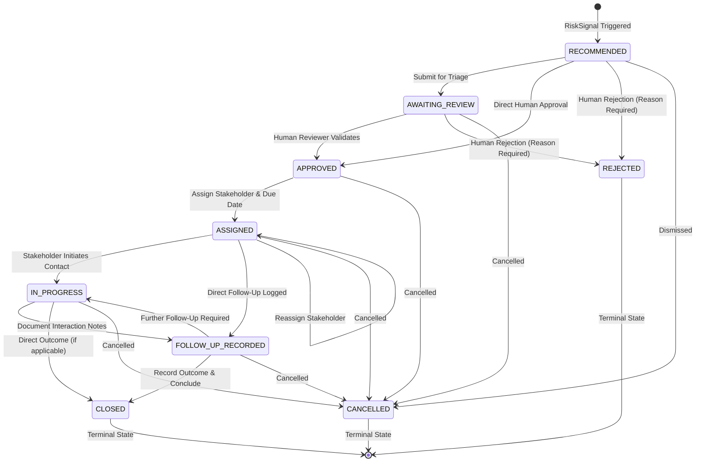

# SUTRA Phase Eighteen — Intervention Orchestration Workflow Design

**Milestone:** CODEX 3.0 PS6 Student Success and Intervention Orchestration Prototype  
**Repository:** `/Users/neemaysmac/Desktop/Sutra`  
**Branch:** `Neemay-ml`  
**Date:** October 2026  
**Status:** Completed and Verified  

---

## 1. Executive Summary & Objective

The CODEX 3.0 PS6 problem statement requires more than dropout prediction or an attendance dashboard. It mandates an **end-to-end, consent-aware Student Success and Intervention Orchestration Engine** that demonstrates accountable action after insight:

$$\text{Student Profile (360°)} \longrightarrow \text{Explainable Risk Signal} \longrightarrow \text{Human Review} \longrightarrow \text{Stakeholder Assignment} \longrightarrow \text{Follow-Up Tracking} \longrightarrow \text{Outcome Recording} \longrightarrow \text{Cohort Metrics Aggregation}$$

Phase Eighteen bridges the frozen machine learning model (Day-30 Logistic Regression Baseline v1.0.0 at threshold 0.46) and the Phase Seventeen multisource synthetic risk signals into a fully functional, accountable intervention workflow.

### Non-Negotiable Operational Principles
1. **Strict Semantic Boundary:**
   $$\text{Recommended Action} \neq \text{Approved Action} \neq \text{Assigned Task} \neq \text{Completed Intervention}$$
2. **Mandatory Human-in-the-Loop:** Risk signals never automatically trigger notifications, outreach, or case assignments. An authorized human reviewer must evaluate empirical evidence and approve or reject the recommendation with documented rationale.
3. **Non-Punitive Mandate:** Risk signals and interventions provide supportive institutional resources (tutoring, advising, scheduling assistance, financial counseling). Disciplinary sanctions, grading penalties, and automated punishments are strictly prohibited.
4. **Least-Privilege Confidentiality Routing:** Sensitive fee indicators, bursary eligibility, and financial hold statuses are restricted to authorized `FINANCIAL_AID_COUNSELOR` roles. Non-financial staff view fee statuses as `RESTRICTED`.
5. **Zero External Side Effects:** All actions, staff identifiers, communications, and outcomes are simulated within local demonstration boundaries. Zero real emails, SMS, or external API calls are dispatched.

---

## 2. Architecture & Component Decomposition

```
┌──────────────────────────────────────────────────────────────────────────────────────────────────┐
│                                   SUTRA BACKEND PLATFORM                                         │
│                                                                                                  │
│   ┌────────────────────────────────┐                 ┌────────────────────────────────────────┐  │
│   │   Frozen ML Baseline (v1.0.0)  │                 │    Synthetic 360° Profile Engine       │  │
│   │   - 25 OULAD Features          │                 │    - Attendance & Recent Trends        │  │
│   │   - Threshold: 0.46            │                 │    - Coursework & Overdue Milestones   │  │
│   │   - SHA-256: 78a08227...       │                 │    - LMS Activity & Digital Footprint  │  │
│   │   - Invariant Active Model     │                 │    - Confidential Fee & Aid Status     │  │
│   └───────────────┬────────────────┘                 │    - Skills & Placement Readiness      │  │
│                   │ (Isolated)                       │    - Structured Faculty Observations   │  │
│                   ▼                                  └───────────────────┬────────────────────┘  │
│   ┌────────────────────────────────┐                                     │                       │
│   │ Candidate Gate: BLOCKED        │                                     ▼                       │
│   │ - Phase 9 Module-Relative      │                 ┌────────────────────────────────────────┐  │
│   │ - candidate_provenance_        │                 │    Explainable Risk Signal Engine      │  │
│   │   verified = False             │                 │    - Deterministic Rules (6 Domains)   │  │
│   └────────────────────────────────┘                 │    - Empirical Evidence Cards          │  │
│                                                      │    - Non-Punitive Supportive Actions   │  │
│                                                      └───────────────────┬────────────────────┘  │
│                                                                          │                       │
│                                                                          ▼                       │
│                             ┌─────────────────────────────────────────────────────────────┐      │
│                             │             Intervention Workflow Engine (State Machine)     │      │
│                             │             - RECOMMENDED -> AWAITING_REVIEW                │      │
│                             │             - APPROVED / REJECTED (Human Gate)              │      │
│                             │             - ASSIGNED (Role, Assignee ID, Due Date)        │      │
│                             │             - IN_PROGRESS -> FOLLOW_UP_RECORDED             │      │
│                             │             - CLOSED (Recorded Outcome Category)            │      │
│                             │             - Internal Overdue Escalation Policy Flags      │      │
│                             └──────────────────────────────┬──────────────────────────────┘      │
│                                                            │                                     │
│                                                            ▼                                     │
│   ┌────────────────────────────────┐                 ┌────────────────────────────────────────┐  │
│   │   Local Demonstration Store    │◄────────────────┤   FastAPI REST API & Interactive UI    │  │
│   │   (ml/data/interventions/      │                 │   - /api/v1/interventions/*            │  │
│   │    cases.json)                 │                 │   - /demo & /interventions/ui          │  │
│   │   - Atomic Serialization       │                 │   - Dynamic Cohort Metrics Aggregator  │  │
│   │   - Immutable Audit History    │                 │   - Role-Based Field Masking           │  │
│   └────────────────────────────────┘                 └────────────────────────────────────────┘  │
└──────────────────────────────────────────────────────────────────────────────────────────────────┘
```

---

## 3. Intervention Lifecycle State Machine

The workflow enforces a strict state machine implemented in [`ml/src/sutra_ml/schemas/interventions.py`](file:///Users/neemaysmac/Desktop/Sutra/ml/src/sutra_ml/schemas/interventions.py) and validated by [`ml/src/sutra_ml/interventions/engine.py`](file:///Users/neemaysmac/Desktop/Sutra/ml/src/sutra_ml/interventions/engine.py):



### Transition Validation Rules
1. **Human Gate Invariant:** A case cannot jump from `RECOMMENDED` or `AWAITING_REVIEW` to `ASSIGNED`, `IN_PROGRESS`, or `CLOSED`. Any attempt raises `ValueError("Human review required before assignment")`.
2. **Mandatory Review Rationale:** Transitioning to `APPROVED` or `REJECTED` requires at least 5 characters of human explanation.
3. **Structured Assignment:** Moving to `ASSIGNED` requires a valid stakeholder role (`AssignedRole`), a synthetic assignee ID (e.g., `STAFF-ADV-04`), and a target due date (`YYYY-MM-DD`).
4. **Follow-Up Documentation:** Logging follow-up requires at least 10 characters detailing student obstacles and support provided.
5. **Outcome Recording:** Concluding a case requires selecting a standardized `OutcomeCategory` and documenting observations.
6. **Immutable Audit History:** Every state transition appends an `AuditEvent` with:
   - `event_id`: Unique event key (`EVT-XXXXXXXX`).
   - `timestamp`: UTC ISO timestamp.
   - `from_status` and `to_status`.
   - `actor_role` and `actor_id`.
   - `action`: Canonical action name.
   - `rationale`: Contextual justification.

---

## 4. Role Permissions & Confidentiality Routing

To prevent student stigmatization and uphold ethical data handling:
- **Roles:**
  - `ACADEMIC_ADVISOR`: General academic guidance, timetable adjustments, attendance inquiries.
  - `COURSE_INSTRUCTOR`: Subject-matter tutoring, assignment makeup, lab assistance.
  - `FINANCIAL_AID_COUNSELOR`: Sensitive fee status, bursary grants, emergency funding.
  - `CAREER_PLACEMENT_OFFICER`: Resume review, mock interviews, placement preparation.
  - `STUDENT_SUCCESS_COORDINATOR`: Holistic queue oversight, case assignment, policy escalation.
- **Financial Aid Confidentiality Gate:**
  - `StudentSuccess360Profile.fee_status` contains administrative fee status and bursary indicators.
  - When accessed by non-financial roles, the API returns:
    ```json
    {
      "status": "RESTRICTED",
      "access_restriction_level": "RESTRICTED_FINANCIAL_AID_ONLY",
      "note": "Fee status and financial hold information are confidential to Financial Aid Counselors.",
      "has_financial_hold": false,
      "days_past_due": 0
    }
    ```
  - Confidential cases (e.g. `SIG-FEE-BURSARY-*`) are omitted from general advisor views and cohort metrics unless authorized.

---

## 5. Overdue Detection & Escalation Policy

- **Simulation Anchor Date:** Default anchor is `2026-10-15` (aligning with Day-30 synthetic cutoff).
- **Overdue Determination:** A case is flagged `is_overdue = True` when:
  $$\text{status} \in \{\text{ASSIGNED}, \text{IN\_PROGRESS}\} \quad \land \quad \text{due\_date} < \text{reference\_date}$$
- **Escalation Levels:**
  - `NORMAL`: Task on schedule.
  - `OVERDUE_FLAGGED`: Target due date elapsed without documented follow-up.
  - `SUPERVISOR_NOTIFIED`: Second-tier internal triage escalation.
- **Safety Guarantee:** Escalation is an **internal workflow flag only**. It never sends external emails, text messages, or automated penalties to students or staff.

---

## 6. Standardized Outcome Categories

When cases are concluded, reviewers record observed synthetic outcomes:
1. `SUPPORT_DELIVERED_FOLLOW_UP_REQUIRED`: Support provided; ongoing monitoring scheduled.
2. `STUDENT_ENGAGEMENT_IMPROVED`: Simulated observations show restored attendance or completed milestones.
3. `NO_MEASURABLE_CHANGE`: Simulated observations unchanged; alternative strategies needed.
4. `UNABLE_TO_CONTACT`: Simulated contact attempts unacknowledged; liaison requested.
5. `REFERRED_TO_ANOTHER_SERVICE`: Case transferred to specialized department (e.g. financial aid or health).
6. `CASE_CLOSED_AFTER_REVIEW`: Human review determined no further intervention needed.

---

## 7. Dynamic Cohort Metrics Engine

Cohort aggregates are computed dynamically from actual student profiles and intervention records:
- Total Synthetic Cohort (100)
- Profiles with active signals requiring human review (24)
- Cases by status (`RECOMMENDED`, `AWAITING_REVIEW`, `APPROVED`, `ASSIGNED`, `IN_PROGRESS`, `FOLLOW_UP_RECORDED`, `CLOSED`, `REJECTED`, `CANCELLED`)
- Overdue tasks count
- Confidential cases count
- Distribution by intervention type and assigned role
- Distribution of recorded outcome categories

Metrics are never hardcoded and update immediately upon state mutation.

---

## 8. Persistence & Storage Contract

- **Store Path:** `ml/data/interventions/cases.json`
- **Concurrency & Safety:** Atomic replacement (`os.replace`) from a `.tmp` buffer ensures zero corrupt writes.
- **Predictable Resets:** `reset_to_seed()` restores 5 initial demonstration cases covering all stages (awaiting review, confidential, overdue, in-progress, and closed).
- **Restart Durability:** All case states, audit histories, and notes persist across application restarts.
