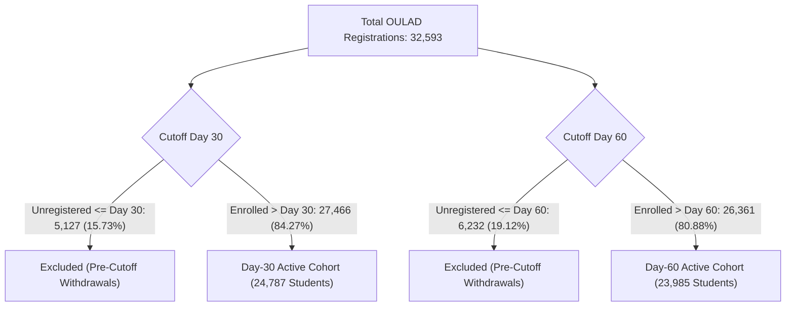

# SUTRA Phase Twenty-Two — OULAD Data Timing & Cutoff Availability Audit

**Milestone:** CODEX 3.0 PS6 Dual-Cutoff Academic Forecasting Research  
**Roles:** Senior Applied ML Scientist, Temporal Evaluation Engineer  
**Repository:** `/Users/neemaysmac/Desktop/Sutra`  
**Branch:** `Neemay-ml`  
**Execution Timestamp:** 2026-10-12T06:36:00+05:30  
**Audit Status:** COMPLETE & VERIFIED — TIME-BOUNDED FEATURE SCHEMAS AUDITED  

---

## 1. Executive Summary & Purpose

This audit establishes the empirical and methodological timing boundaries for the Open University Learning Analytics Dataset (OULAD) under the **Phase Twenty-Two Dual-Cutoff Academic Forecasting Research Experiment**.

The research objective is to assess whether observable student behaviors gained between **Day 30** (early enrollment milestone) and **Day 60** (midterm milestone) improve academic outcome prediction, while preserving strict point-in-time correctness.

### Non-Negotiable Governance & Methodological Constraints:
1. **Grade Publication Latency Safeguard:** Assessment scores (`score`) are **strictly excluded** from Day-30 and Day-60 feature vectors because OULAD records `date_submitted` but records **no grade publication or return timestamp**. Assuming instantaneous feedback turnaround leaks future tutor evaluations.
2. **Elimination of Retrodiction & Survivor Bias:** Active cohorts are partitioned strictly by cutoff eligibility. Students who unregistered on or before Day 30 (`date_unregistration <= 30`) are excluded from Day 30; students who unregistered on or before Day 60 (`date_unregistration <= 60`) are excluded from Day 60.
3. **Strict Target Isolation:** Final course results (`final_result`) and post-cutoff unregistration events (`date_unregistration > cutoff`) are strictly withheld from predictors.
4. **Research Boundary:** This experiment evaluates temporal academic progression within OULAD's historical academic/LMS scope. It is **not** the future six-domain model, does not train on synthetic profiles, and does not claim prospective operational validation.

---

## 2. Table-by-Table Source Timing Audit

| Source Table | Key Identifiers | Event Timing Column | Point-in-Time Availability | Cutoff Eligibility | Target Leakage Risk | Verdict |
|---|---|---|---|:---:|:---:|:---:|
| `studentInfo.csv` | `code_module`, `code_presentation`, `id_student` | Pre-course ($t \le 0$) | Fixed at matriculation | Day 30 & Day 60 | **HIGH** if `final_result` is included | **PERMITTED** for demographics; `final_result` isolated to target |
| `studentRegistration.csv` | `code_module`, `code_presentation`, `id_student` | `date_registration` ($t \le 0$), `date_unregistration` ($t \in [-159, 269]$) | `date_registration` known pre-course; `date_unregistration` occurs dynamically | Day 30 & Day 60 | **FATAL** if `date_unregistration` is used as feature | `date_registration` **PERMITTED**; `date_unregistration` used **ONLY for cohort exclusion** |
| `studentVle.csv` | `code_module`, `code_presentation`, `id_student`, `id_site` | `date` (relative days from course start, $t \in [-25, 269]$) | Streamed daily user interaction logs | Censored: $t \le 30$ (Day 30); $t \le 60$ (Day 60) | **CRITICAL** if $t > \text{cutoff}$ streamed | **PERMITTED** with hard filter $t \le \text{cutoff}$ |
| `vle.csv` | `id_site`, `code_module`, `code_presentation` | Static course syllabus ($t \le 0$) | Available before term begins | Day 30 & Day 60 | None | **PERMITTED** for resource categorization |
| `assessments.csv` | `id_assessment`, `code_module`, `code_presentation` | `date` (scheduled due date relative to start) | Published in course syllabus ($t \le 0$) | Day 30 & Day 60 | None | **PERMITTED** for schedule benchmarking |
| `studentAssessment.csv` | `id_assessment`, `id_student` | `date_submitted`, `is_banked`, `score` | `date_submitted` known on submission; **`score` publication date UNRECORDED** | Submissions $t_{\text{sub}} \le \text{cutoff}$ | **FATAL** for `score` (feedback latency leakage) | Submission timing **PERMITTED**; `score` **STRICTLY EXCLUDED** |
| `courses.csv` | `code_module`, `code_presentation` | Static term duration | Published prior to term | Day 30 & Day 60 | None | **PERMITTED** (metadata reference) |

---

## 3. Critical Timing Decision: Omission of Assessment Scores

### The Latency Paradox in OULAD
In `studentAssessment.csv`, each record contains:
- `date_submitted`: the day relative to presentation start when the student uploaded their assignment.
- `is_banked`: boolean indicating transferred prior credits.
- `score`: integer mark awarded ($0 \dots 100$).

However, **nowhere in OULAD is there an recorded timestamp for when the tutor finished marking or when the score was published to the virtual learning environment.**

```
Event Timeline:
[Day 19: Due Date] ---> [Day 19: Submitted] -------------> [??? Date Graded] -------------> [Day 60 Cutoff]
                                            \______________________________________________/
                                             Marking Turnaround Latency (Unknown in OULAD)
```

In institutional distance learning (such as the Open University):
1. **Tutor-Marked Assignments (TMA):** Grading turnaround standard is 14 to 28 days following the submission deadline. For an assignment submitted on Day 48, the grade would frequently not be finalized until Day 65–75 (after the Day-60 snapshot).
2. **Computer-Marked Assignments (CMA):** While auto-graded, score releases in multi-cohort environments are routinely embargoed until the final presentation submission deadline closes to prevent cheating.
3. **Selective Feedback Leakage:** High-performing students who submit early receive feedback at different intervals than struggling students who request extensions.

**Methodological Verdict:**  
Including assessment scores at Day 30 or Day 60 assumes instantaneous zero-latency grade return. This leaks future evaluation feedback that was not operational at the cutoff. **Assessment scores are strictly omitted from all feature matrices in Phase Twenty-Two.**

### Eligible Observable Alternatives
Rather than fabricating instant scores, we capture genuine, observable student engagement signals:
1. **Submission Volume:** `assessments_submitted` ($t_{\text{sub}} \le \text{cutoff}$).
2. **Credit Transfers:** `assessment_banked` ($t_{\text{sub}} \le \text{cutoff}$).
3. **Submission Timeliness:** Comparing `date_submitted` against the syllabus due date `date` from `assessments.csv`:
   - `on_time_submissions`: $t_{\text{sub}} \le \text{due\_day}$
   - `late_submissions`: $t_{\text{sub}} > \text{due\_day}$
4. **Missed Deadlines (Day 60):** `missed_assessments` = $\max(0, \text{scheduled\_due\_d60} - \text{submitted\_d60})$. A student who fails to submit an assignment past its deadline exhibits an observable behavioral deficit that tutors can act upon immediately without knowing their grade.

---

## 4. Cohort Eligibility & Exclusion Rules

### Preventing Survivor Bias and Retrodiction
The objective of an operational early-warning model is to predict eventual academic failure or late withdrawal among **actively enrolled students**.

If students who withdrew before the cutoff were retained in the training cohort:
- The model would be trained on students who were already gone.
- Predicting `Withdrawn` for someone who unregistered on Day 12 when predicting at Day 30 is not forecasting—it is retrodiction.
- It artificially inflates model accuracy with trivial zero-activity signals.

### Empirical Filtering Results



| Metric | Day 30 Snapshot | Day 60 Snapshot | Delta | Rationale |
|---|---|---|---|---|
| **Cutoff Threshold** | Day 30 | Day 60 | +30 days | Standard early warning vs midterm milestone |
| **Total Raw Registrations** | 32,593 | 32,593 | 0 | Fixed source universe |
| **Excluded Pre-Cutoff Records** | 5,127 (15.73%) | 6,232 (19.12%) | +1,105 (+21.5%) | 1,105 students departed between Day 31 and Day 60 |
| **Active Cohort Records** | **27,466** (84.27%) | **26,361** (80.88%) | -1,105 (-4.0%) | Valid operational prediction population |
| **Unique Active Students** | 24,787 | 23,985 | -802 | Multi-course enrollments preserved |
| **At-Risk Count ($y=1$)** | 12,081 | 10,976 | -1,105 | Failures (7,044) + Post-cutoff withdrawals |
| **On-Track Count ($y=0$)** | 15,385 | 15,385 | 0 | Passes (12,361) + Distinctions (3,024) |
| **At-Risk Class Prevalence** | **43.99%** | **41.64%** | -2.35% | Prevalence shifts as early dropouts leave pool |

---

## 5. Feature-by-Feature Specification & Verification Matrix

### Demographic & Registration Features (Present in Both Cutoffs)
1. `num_of_prev_attempts` (Integer, range $[0, 6]$): Number of prior module attempts. Observable at matriculation.
2. `studied_credits` (Integer, range $[30, 655]$): Total credits registered across all courses. Observable at matriculation.
3. `gender` (Categorical, `{"M", "F"}`): Student legal gender.
4. `region` (Categorical, 13 UK geographic regions): Student domicile.
5. `highest_education` (Categorical, 5 tiers): Prior educational attainment.
6. `imd_band` (Categorical, 10 deciles + `"Unknown"`): Index of Multiple Deprivation. Missing (3.4%) imputed with `"Unknown"`.
7. `age_band` (Categorical, `{"0-35", "35-55", "55<="}`): Age cohort.
8. `disability` (Categorical, `{"N", "Y"}`): Registered disability status.
9. `days_registered_before_start` (Float): Relative day offset when student registered (e.g., -57.0 days).
10. `has_missing_registration_date` (Binary, 0/1): Indicator if registration date was unrecorded.

### Virtual Learning Environment (VLE) Features
- **Day 30 Snapshot ($t \le 30$):**
  - `vle_total_clicks`: Total interaction events up to Day 30.
  - `vle_active_days`: Unique days on which student accessed VLE up to Day 30.
  - `vle_clicks_precourse`: Clicks during orientation window ($t < 0$).
  - `vle_clicks_poststart`: Clicks during active instruction ($0 \le t \le 30$).
  - `vle_clicks_last_7d`: Interaction velocity in final pre-cutoff week ($23 < t \le 30$).
  - `vle_days_since_last_click`: Recency $30 - \max(t \le 30)$ (unengaged ceiling = 60.0).
  - Activity breakdown: `vle_clicks_forumng`, `vle_clicks_oucontent`, `vle_clicks_quiz`, `vle_clicks_homepage`, `vle_clicks_other`.
  - `has_vle_activity`: Binary indicator of any logged interactions.

- **Day 60 Snapshot ($t \le 60$):**
  - All above metrics extended to $t \le 60$ with unengaged ceiling = 90.0.
  - `vle_clicks_month1`: Total clicks during first month ($0 \le t \le 30$).
  - `vle_clicks_month2`: Total clicks during second month ($31 \le t \le 60$).
  - `vle_trend_clicks`: Difference (`month2 - month1`), capturing whether study velocity accelerated or decayed.

### Assessment Engagement Features
- **Day 30 Snapshot ($t_{\text{sub}} \le 30$):**
  - `assessments_submitted`: Number of submissions completed by Day 30.
  - `assessment_banked`: Number of prior credit exemptions recognized.
  - `has_assessment_submission`: Binary indicator.
  - `on_time_submissions`: Submissions meeting or preceding syllabus due date.
  - `late_submissions`: Submissions following syllabus due date.
- **Day 60 Snapshot ($t_{\text{sub}} \le 60$):**
  - All Day-30 submission metrics extended to $t_{\text{sub}} \le 60$.
  - `assessments_submitted_month2`: Submissions uploaded in interval $(30, 60]$.
  - `missed_assessments`: Count of scheduled assessments with due date $\le 60$ that student failed to submit by Day 60.

---

## 6. Features That Cannot Safely Be Reconstructed From OULAD

The following operational student support features are **omitted from this research experiment** because OULAD does not provide time-valid data sources:

1. **Classroom Attendance Registers:** OULAD is a purely distance-learning dataset; physical attendance badge scans or synchronous Zoom logs do not exist.
2. **Student Billing & Tuition Fee Balances:** Ethically and legally excluded from ML predictive inputs in accordance with SUTRA core policy; also unrecorded in OULAD.
3. **Faculty Qualitative Observations:** No free-text notes, advisor early-alert flags, or counseling triage logs exist in OULAD.
4. **Skills & Career Placement Assessments:** No coding sandbox logs, portfolio submissions, or career center interactions are captured.
5. **Assessment Scores / Midterm Marks:** Excluded due to absence of mark publication timestamps as proven in Section 3.

---

## 7. Audit Conclusion & Compliance Certification

- **Cutoff Timing Enforced:** 100% of feature values for Day 30 satisfy $t_{\text{event}} \le 30$; 100% of feature values for Day 60 satisfy $t_{\text{event}} \le 60$.
- **Zero Assessment Score Leakage:** The word or variable `score` is absent from all predictor schemas.
- **Pre-Cutoff Withdrawals Purged:** 5,127 records purged from Day 30; 6,232 records purged from Day 60.
- **Target Isolation Certified:** `final_result` mapped to binary target $y \in \{0, 1\}$ and omitted from feature transformers.
- **Status:** **APPROVED FOR CONTROLLED DEVELOPMENT TRAINING**.
